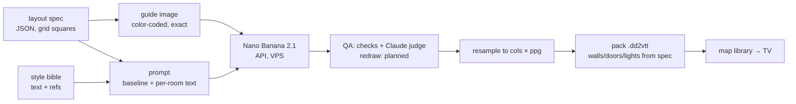

# AI art — vision and the map pipeline

Vision for generated art in battlemap (maps first, then characters, items, effects) and the
design of the first piece: a **fully API-driven map pipeline** on Nano Banana 2.1. Status
2026-10-10: **pipeline built and working** (`tools/mapgen/`, see "built"): doors drawn by
battlemap, ruins as a layout flag, free checks + a Claude judge; prompt not tuned yet; no
packed map loaded on a TV yet. **What we learned about getting good maps out of the model:
"learned so far".** Prices and model ids are from Google's own pricing page and changelog on
that date — they churn (see "model churn").

## Principles

- **Everything through the API, everything else on our side.** No web UI, no subscription
  app in the loop. Every step is a script we own, so each step can later get its own UX
  (companion screens) without changing the model side.
- **Our data is the truth, the model only paints.** Geometry (grid, walls, doors, lights)
  comes from a layout we own; the image model never decides where a wall is. That keeps fog,
  doors and room reveal working exactly as with Dungeondraft maps.
- **Heavy work off the TV.** The TV box (2 GB RAM, Mali GPU) only renders. Generation,
  checks, resampling, upscaling and packing run on the VPS (or the Mac for anything that
  wants Apple-silicon compute). The TV receives a finished `.dd2vtt` like any other map.
- **One style bible.** A fixed style text plus 3–5 reference images go with every request,
  so maps, tokens and items look like one world.

- **Paint the still, render what moves** (Konrad, 2026-10-10 — direction, try it once the
  effects exist). The painting holds only what never changes. Anything that moves, toggles or
  glows is left out of it and drawn by battlemap on top of the image: doors first (done,
  "doors are battlemap's"), later fire, torch and brazier flames, light pools, water shimmer, smoke. The layout already
  knows where they go (lights, water areas), so the prompt asks for unlit braziers, empty
  sconces and evenly lit floors, and the effect layers ("torch/light animations", "water
  animation" in `feature-ideas.md`) add the life — animated and switchable from the phone.

## Subscription vs API (verdict)

There is no Claude-Code-like "one subscription with a usage limit" for API use:

| | what it is | images | API? |
|---|---|---|---|
| Google AI Pro (€21.99/month) | Gemini *app* subscription | ~100 Nano Banana images/day **in the app** | no key; includes **$10/month Google Cloud credit** (Google Developer Program, must be activated) usable on the Gemini API |
| Gemini API (AI Studio key + billing) | pay per image | unlimited, rate-limited per project | yes — **image models have no free tier** |

Nano Banana 2.1 (`gemini-nano-banana-2.1`) per image, standard / batch (batch = async,
half price, results within hours):

| size | standard | batch |
|---|---|---|
| 1K | $0.034 | $0.017 |
| 2K | $0.050 | $0.025 |
| 4K | $0.113 | $0.057 |

A month of map development (drafts at 1K, a few dozen finals at 4K) is roughly **$5–20**.
The $10 credit in AI Pro covers ~200 2K or ~90 4K images. **Recommendation:** for the
pipeline, an AI Studio key with billing and a budget alert is enough; AI Pro only pays off if
the Gemini app is also wanted for hand exploration.

## Built (v0, 2026-10-10)

`tools/mapgen/mapgen.py` (Python 3, Pillow + numpy; runs on the Mac or the VPS):

| command | does | cost |
|---|---|---|
| `guide layouts/<name>.json` | renders the guide PNG only | free |
| `paint layouts/<name>.json --size 1K\|2K\|4K --n N [--thinking …] [--refs …] [--tag …] [--why "…"] [--round N] [--judge] [--pack]` | guide + prompt → model → overlay, door preview, free checks per image → `meta.json`; `--judge` judges and waits; `--pack` packs the best (judge first, see `pack`); rebuilds the board | per image, see prices |
| `pack out/<name>/<run>` | packs the run's best image: judge verdict "use", then judge score; unjudged: no high check issue, fewest issues, QA score → `<run>/<name>.dd2vtt`, `"packed"` in `meta.json` | free |
| `pack layouts/<name>.json <image> [--ppg N] [--png]` | writes `<name>.dd2vtt` (WebP image, walls/doors/lights from the layout, `"battlemap": {"draw_doors": true}`) — into the image's run folder (recorded as packed) when it has one | free |
| `doors layouts/<name>.json <image> [--open] [--grid]` | the painting with battlemap's doors drawn on (`doors_N[_open][_grid].jpg`) — the TV look without a TV | free |
| `check out/<name>/<run>` | the free checks again (they also run inside `paint`): issues into `meta.json`, `suspects_N.jpg`, `grid_N.jpg` | free |
| `judge out/<name>/<run> [--wait] [--pack] [--model …]` | a Claude helper session (subscription, `claude-bridge headless`) judges every image → `judge_N.json`; `--pack` waits, then packs the judge's best; with `--wait` the board is rebuilt | subscription |

Runs land in `tools/mapgen/out/<name>/<timestamp>-<tag>/` (gitignored): `guide.png`,
`prompt.txt`, `out_N.jpg`, `overlay_N.jpg` (our walls cyan, doors red over the painting),
`doors_N.jpg` (painting + battlemap's doors, shut), `grid_N.jpg` (painting at exact squares +
grid, for coordinates), `suspects_N.jpg` (crops of what the free checks flagged), `judge_N.json`
(after `judge`), `meta.json` (layout path, model, size, QA, issues, lint, token usage,
estimated cost; for the board: `round`, `why` — the run's question —, optional `finding`
added after looking, `packed`, `draw_doors`). Prompt template:
`tools/mapgen/prompts/baseline.txt`. Sample layouts: `crypt` (16 × 16) and `keep` (32 × 18,
16:9).

**Board:** every test image lives on the horizon board **`battlemap-mapgen`** — guides,
paintings with numbered pins on the features they show (pins in grid squares), the small
pictures (doors open, grid, QA overlay, check crops), and blue slots for the next images.
Konrad's rule (2026-10-10): **every new image from this test project goes onto that board**.
Since step 4 the board is **built from the run folders** (`tools/mapgen/board.py`): one zone
per `round` (title from the tags, text from `why` + `finding`, totals and judge verdicts),
one plate per painting — the doors preview as the image, the judge's verdict, score and note
as its intro, pins from `judge_N.json` (`good` green, issues red/amber/grey by severity,
rejected checks grey) or, unjudged, the free checks as amber "unconfirmed" pins; the packed
image says PACKED. `paint`, `judge --wait` and `pack` rebuild it, so a run needs no edit there.
Hand-written in `board.py`: the two test layouts, `NOTES` (what was seen by eye on runs 1–3,
before the judge wrote `good`; their `id`s keep the walk `overview` working), the `NEXT`
slots and Juri's zone. A new run joins the zone of an earlier run with the same tag (crypt
and keep painted for one question), else opens the next round; `--round N` overrides.

**Setup gotchas (2026-10-10):** the card's 3-D Secure check (Cardinal Commerce) is blocked
by Cloudflare inside telescope → pay in a normal browser; Google Cloud in Germany takes card
or bank debit, **no PayPal**; check which Google account a browser shows before paying (the €20
landed on Bao's account by accident); a key on a project without billing answers 429
`free_tier_requests, limit: 0`.

**Account:** API key from 1Password `dev` → **Gemini API - battlemap (Bao billing)**
(`$MAPGEN_OP_ITEM`, or `$GEMINI_API_KEY`). This is Bao's Google account (nico.zingerle),
prepaid €20, no auto-refill — a temporary home: Konrad's own account (ko) has a project + key
(**Gemini API - battlemap**) but no billing yet. Without billing the API answers 429 with
`free_tier_requests, limit: 0`: image models have no free tier.

**Layout spec** — grid units, origin top-left:

```json
{"name": "crypt", "grid": [16, 16], "setting": "an old crypt", "outdoor": false,
 "areas": [{"id": "hall", "rect": [3, 3, 10, 8], "desc": "…"},
           {"id": "pool", "kind": "water", "in": "hall", "rect": [10, 8, 3, 3], "desc": "…"}],
 "doors": [{"x": 7, "y": 11, "side": "n"}],
 "lights": [{"x": 5, "y": 3.3, "range": 4, "color": "ffb060"}],
 "props": [{"rect": [7, 5, 2, 3], "desc": "carved sarcophagus"}]}
```

- Every area is a room; **walls run between different rooms** and between a room and rock.
  Terrain lying inside a room names its host with `"in"` (no walls around it).
- Rooms that share a wall must touch (`rect`s adjacent); a door sits on one side (`n/s/e/w`)
  of a cell on that shared edge.
- `kind`: `floor` (default), `water`, `rubble`, `vegetation`, `solid` (pillars, rock).
  `"outdoor": true` makes uncovered cells open ground instead of rock.
- `"ruined": true` on an area: its prompt line gets "ruined inside only … its walls stand
  complete and unbroken". Damage goes here, never into `desc`/`setting`: words like
  "collapsed", "ruined", "breach", "hole" made the model open walls (run 1). `mapgen.py` lints
  the texts for such words and warns (also stored in `meta.json` → `lint`).

**Judge (step 3, 2026-10-10):** two layers, both write issues with x/y in squares.
- **Free checks** (`check()`, inside every `paint`): a wall edge counts as *open* when both its
  outline step and its colour spread across the line fall below 45 % / 60 % of the image's
  median wall edge (relative, so style-independent); a *marker* is pure yellow (R = G) at a
  light. Calibrated on all keep runs: every flagged opening I checked by eye was a real breach
  except one banner hanging over a wall; painted flames don't trip the marker check, the one
  leaked dot does. Crops of each spot: `suspects_N.jpg`.
- **Claude judge** (`judge`, prompt `prompts/judge.txt`): a helper session reads guide, painting,
  grid and overlay per image, confirms or rejects each check spot, finds the rest, writes
  `judge_N.json` (flags, score 1–10, verdict use/retry, issues with a short `title`, up to
  three `good` spots, rejected checks — `title` and `good` since step 4, for the board). Run 3 took
  ~5 min for 3 images: image 1 retry (the exit, confirmed), image 2 use 8/10 (the banner spot
  rejected with the right reason), image 3 use 5/10 (the dot, plus door-like pale strips in outer
  walls). It also caught what the checks can't: a torch painted 2.6 squares from its light,
  doorway frames that eat the wall stub beside a doorway. Runs with `--permission-mode auto`:
  under `acceptEdits` its first shell command waited for an approval no one sees and hung.

**Doors are battlemap's** (since run 2): the guide leaves a doorway as a gap, the `.dd2vtt`
carries `"battlemap": {"draw_doors": true}` (other VTTs ignore it), and battlemap's
`PortalComponent` draws a top-down wooden leaf in the wall line that swings open (~85°, 0.4 s,
eased) when the DM toggles it. The leaf hinges at `bounds[0]`; `pack` writes a double door's
second leaf hinge-last so the pair opens from the middle, and a leaf always opens to the south
of an east–west wall / east of a north–south wall. Maps without the flag (Dungeondraft) keep
the old marker. `mapgen.py doors` draws the same leaf in Python for the board — keep the two
in step (size, colours) when either changes.

**Known gaps:** the QA score (edge strength on wall lines ÷ inside rooms, 0.9–1.3) does not
rank images — the free checks and the judge do (`pack` follows the judge when it has run);
no automatic redraw on a high issue; `est_cost` ignores thought tokens; style refs (`--refs`),
2K/4K and the batch tier untried; no packed map loaded on the TV yet (drawn doors are checked
by unit tests and an offscreen render of the real component, not on a device).

## Learned so far — Nano Banana 2.1 for battle maps (runs 1–3, 2026-10-10)

Twelve paintings at 1K over two layouts (crypt 16 × 16, keep 32 × 18), ≈ $0.55 with the first
tests. The distilled rules; evidence is on the board (`battlemap-mapgen`) and in the run log
below. Start every prompt change from here. Editing an existing map (Juri's labels-off job)
has its own lessons: "editing a published map" below.

**What works — keep doing it**

| practice | evidence |
|---|---|
| A colour-coded guide as the first image + "the guide is exact, keep every wall" | walls land on our layout in every draw (overlay), 16:9 and 1:1 alike |
| One text line per area, columns/rows 1-based | described things land where the text says: hearth on the north wall, banners in the corridor, bunks, ossuary shelves, stairs out of the crypt |
| Props as magenta blocks + a text line | the knight's sarcophagus and the feasting table sit on their blocks |
| Leave out what battlemap renders (doors now; later light, fire, water) | with a gap in the guide and "no doors" in the prompt: no painted door in 7/7 draws — but a thin rail across every doorway (failures) |
| Damage as a layout flag (`"ruined": true`) + the blanket rule "every wall stays whole" | courtyard walls kept in 3/3 draws; with ruin words in the text they broke in 4/4 keep draws |
| Draw 2–3 per layout, pick by checks + judge | draws under one prompt differ a lot (one clean, one breached); the QA score picks wrong |
| Resample to exact squares on our side | the model's sizes are fixed (16:9 at 1K = 1376 × 768 ≈ 43 px/square); `pack` and `exact()` resample to cols × ppg |

**Failure catalogue**

| failure | seen | cause → what we do | status |
|---|---|---|---|
| Door markers leak (red lines, red sills) | run 1, 4 of 5 | marker colours get painted as they are → no door markers at all, doorways are gaps | fixed (run 2) |
| Doors drawn side-on (face laid flat), each in another style | run 1 | the model can't do a top-down door → battlemap draws doors | fixed (run 2) |
| Ruin words open walls ("collapsed", "ruined") | runs 1–2, every keep draw | text beats geometry → `"ruined"` flag + wall rule + lint on the texts | fixed (run 3) |
| Invented exit: a path through a wall to the map edge | run 3, 1 of 3 | not asked for, the wall rule doesn't stop it → check `opening` + judge, redraw | caught, not prevented |
| Guide colours painted flat: the yellow light dot left as is; black rock gap and near-black walls as flat black bars | run 3 (dot), run 2 (bars), 1 draw each | the legend says what to paint, not "never flat" → tuning: softer guide colours, "render every colour as texture" | caught (dot: check, bars: judge), not prevented |
| Light source moved: torch ~2.6 squares from its light | run 3, 2 of 3 | the model puts a light on the nearest wall or hearth → judge flags; once battlemap renders lights ("paint the still") the painting holds none | open |
| A thin wooden rail (a post at each end) across every doorway — a shut door when battlemap's door is open | runs 2–3, 7 of 7 draws, every doorway (judge, step 4; by eye I had read it as "empty doorway / threshold only") | the model frames an opening like a door frame → prompt: "the floor runs straight through each doorway, no threshold, rail, sill or beam"; a free check for doorway edges that look closed | caught (judge, medium), not prevented |
| Doorway frames wider than the doorway eat the wall stub beside it: the corridor ends open two squares wide where the layout has a one-square doorway; pale door-frame strips in outer walls read as exits | runs 2–3, every keep draw | the model decorates openings, and a 2-square corridor invites a 2-square opening → judge flags; prompt tuning, or doorways as wide as the corridor in the layout | caught (judge), not prevented |
| The edge-gradient QA score does not rank | runs 1–3 (the top score was the breached draw twice) | use checks + judge; the score stays as a number in `meta.json` | known |

**Measured:** 1K costs $0.034 and takes 16–32 s per image, 43–64 px per square: fine for
drafts, finals need 4K (≥ ~100 px per square). `thinking` high: +~2.4k thought tokens, ~30 s,
no visible gain at 1K. Untried: style refs, 2K/4K, batch tier.

**Checks and judge in practice:** the free pixel check is fooled by objects hanging over a wall
(a banner), the judge rejects those; a torch out of place or a doorway frame that eats a wall
are judge-only. The judge needs `grid_N.jpg` to read coordinates, runs 1–5 min for 2–3 images,
and must run with `--permission-mode auto` and Read/Write only: a headless session can't answer
a permission prompt, and under `acceptEdits` its first shell command hung it for good.
**The judge is not stable yet:** the first run-3 judge called every doorway clean and gave the
test map use 8/10; after one sentence about rails was added, the next judge found a rail at
every doorway and the corridor ends two squares wide → retry 5/10 (still the best of the
three). It sees what it is told to look for — name each failure in `judge.txt`, and better:
hand it a crop per doorway (like `suspects_N.jpg`) so it checks every opening, not a 1376 px
overview.

### Run log

**Run 1 — prompt v0 (1K, ~20 cents):** both sample maps keep our geometry almost exactly — walls,
doors, the flooded corner, the corridor all land on the layout (overlay check by eye). The
model paints doors where the red bars are, uses the `desc` text per room, keeps the grid off.
Thinking `high` adds ~2.4k thought tokens (billed as text output, a fraction of a cent) and
~30 s; no visible gain at 1K. 1K gives only 50–64 px per square — finals need 4K.

**Run 2 — doorways (2026-10-10, 4 images at 1K, ~14 cents):** guide without red bars,
prompt "open doorways, no doors": all four paintings show openings without a painted door,
no red, no side-on doors. Battlemap's drawn doors sit cleanly in the wall line (board, zone
"run 2"). Judged later (step 4): a thin wooden rail crosses every doorway in all four — read
by eye as "empty doorway" or "threshold only"; all four retry.
Still open: ruin text breaks the courtyard walls (step 2 → run 3); one keep draw painted the
guide's black rock gap and walls as flat black bars.

**Run 3 — ruins in the layout (2026-10-10, keep × 3 at 1K, ~10 cents):** courtyard marked
`"ruined": true`, no ruin words in any text, prompt rule "every wall stays whole". All three
keep every courtyard wall (run 1: broken in both draws). New failure in one draw: an invented
exit through the south wall to the map edge — and that draw had the best QA score. Image 2 is
packed as the test map (`out/keep/261010-173421-ruined/keep.dd2vtt`), with a grid preview
(`mapgen.py doors … --grid`). Another draw shows the yellow light dot as is. Re-judged in
step 4 with the rail named in the judge prompt: all three retry (rails at every doorway,
corridor ends two squares wide); image 2 stays the best (5/10) and the packed map.


## Next — pick up here (hand-off 2026-10-10)

**Start of a session on this sub-project:** read this file, open the board
(`horizon open battlemap-mapgen`, walk: `horizon present battlemap-mapgen overview`), check
the budget (prepaid €20 on Bao's account, usage below — AI Studio → Ausgaben, signed in as
nico.zingerle), read "learned so far" before changing a prompt. Every new image goes onto the
board (rule above).

**Where it stands (2026-10-10, third session):** steps 1–4 are done; runs 2 and 3 are judged
(`judge_N.json`) and the board is built from the run folders. ≈ $1.10 of the €20 used (map
runs ≈ $0.55, Juri's edit ≈ $0.55; judging is on the subscription). Test map for the table:
the run-3 keep (`out/keep/261010-173421-ruined/keep.dd2vtt`, the judge's best at 5/10 —
retry for the doorway rails and the two-square corridor ends; grid preview
`doors_2_grid.jpg`). Judging run 2 found the rail across every doorway (failure catalogue) —
the TV test shows how much it matters with battlemap's door open.

**Steps, in order** (one at a time, each onto the board before the next):

1. ✅ **Doors drawn by battlemap** (run 2) — "doors are battlemap's" above; drawn in code,
   no sprite; also the "door animations" idea in `feature-ideas.md`.
2. ✅ **Ruins in the layout** (run 3) — `"ruined": true`, see the layout spec.
3. ✅ **Judge** — free checks + Claude helper session, "judge (step 3)" above. Gemini Flash as
   judge only later, for unattended server runs (a "paint" button on the phone).
4. ✅ **Board from data** — "board" above: zones per round from `meta.json`, pins from
   `judge_N.json` (`good`, issues, rejected checks); `pack` follows the judge; `paint`,
   `judge --wait`, `pack` rebuild the board. `paint --why "…" --judge --pack` is the whole
   loop in one command.
5. **On the TV:** the run-3 keep (and a crypt) on the Android bench (`tools/android_bench.sh`,
   AVD `bm_tv`): do fog, doors and room reveal match the painted walls; do the drawn doors read
   at TV size (the leaf is 0.14 squares thick) and swing on a tap from the phone?
6. **4K finals + the tuning grid** (below), run by the helper session; this session gets a
   short summary + the board. The tuning grid now also targets the open rows of the failure
   catalogue — first the doorway rail and the two-square corridor ends (prompt: "the floor
   runs straight through each doorway"), with a per-doorway crop sheet for the judge so its
   verdicts stop drifting.
7. **Later, once battlemap has light / fire / water effects:** extend "paint the still,
   render what moves" — prompt for unlit sources and even lighting, render flames, light and
   water as layers (try list, not scheduled).

## Map pipeline



1. **Layout spec** (JSON) — grid size in squares, rooms/corridors as polygons on the grid,
   doors, light sources, terrain areas (water, rubble, vegetation), props, and a short text per
   room ("altar on the north wall, cracked pews"). Sources, in order of build: hand-written →
   Claude/Gemini text model from a description → procedural generator → a layout editor in
   the companion.
2. **Guide image** — rendered from the spec at an exact pixels-per-square, color-coded:

   | color | meaning |
   |---|---|
   | black `#000000` | outside the map, solid rock |
   | mid grey `#808080` | floor |
   | near-black `#202020`, ¼ square thick | walls |
   | gap in the wall, floor runs through | doorway — battlemap draws the door (since run 2; run 1 used a red bar) |
   | blue `#2060FF` | water |
   | brown `#A07040` | rubble / difficult terrain |
   | green `#30A030` | vegetation |
   | yellow dot `#FFFF00` | light source (brazier, torch) |
   | magenta `#FF00FF` | prop, described in the prompt by grid position |

   Faint grid lines in the guide or none: open question for tuning.
3. **Model call** — guide + style references (≤ 14 images total, ≤ 10 objects for 2.1;
   `--refs` exists but is untested) + prompt. Aspect ratio picked from the grid (16:9 → e.g. 32 × 18 squares fills the TV). Drafts
   at 1K, final at 4K; aim for ≥ ~100 output px per square or detail turns to mush.
4. **QA** — per image: the edge-overlap score, the overlay (our walls and doors over the
   painting), and the **free checks** (`check()`: wall edges that look open, guide markers
   left). The **judge** (`judge`, a Claude helper session) confirms or rejects the check's
   spots and finds the rest. `pack` takes the judge's best ("use", then score), unjudged the
   image without a high issue, then fewest issues, then the score. No automatic retry yet.
5. **Resample** to exactly `cols × ppg` by `rows × ppg` (the model's sizes are fixed, the grid
   is ours). Optional upscale on the Mac.
6. **Pack `.dd2vtt`** — image (base64), `resolution` (`map_size`, `pixels_per_grid`),
   `line_of_sight` from the spec's walls, `portals` from its doors, `lights` from its lights,
   plus `"battlemap": {"draw_doors": true}`. The TV loads it like any `.dd2vtt`
   (`lib/model/uvtt_map.dart`) and draws the doors itself.
7. **Upload** to the VPS map library through the dev server, like any map — by hand today
   (companion map upload, or `PUT /upload/<name>` on the dev server); not automated yet.

**Variants on the same geometry** — night, burning, flooded, after the battle: an edit of the
final image (multi-turn, `previous_interaction_id`) with the same guide. Same walls, different
paint. A later battlemap feature can swap the image mid-session and keep fog and doors.

**Big maps** — later: generate in tiles with overlap, the neighbor tile as a reference, blend
seams on our side.

### Prompt baseline (v0 + doorway and wall rules, untuned)

The template is the file `tools/mapgen/prompts/baseline.txt` (not copied here, so it can't
drift). Placeholders: `{cols}` `{rows}` `{setting}` `{style}` `{areas}` (one line per area
and prop with its columns/rows). Default style lives in `build_prompt` in `mapgen.py`. Its
shape: straight-down orthographic view → "repaint the guide, keep every wall" + "every wall
stays whole, damage stays inside" → the legend (gaps = empty doorways, no doors anywhere) →
scale (5 ft squares) → style → even lighting, calm floors → no grid / text / creatures →
details by area (a `"ruined"` area gets the fixed `RUINED` text). Why each rule is there:
"learned so far". **The legend text must match `COLORS` in `mapgen.py`** — change both
together. The judge's prompt is `prompts/judge.txt` (JSON shape in it).

### Tuning plan (≈ $1 at 1K)

3 layouts (dungeon rooms, outdoor clearing, tavern) × variants, scored by the judge (Next, step 3) and by
eye on the TV:

- guide with vs without faint grid
- legend in the prompt vs a legend image as second input
- `thinking_level` minimal / medium / high (2.1 default medium)
- style refs: none vs 3 images
- 16:9 vs 1:1 at the same squares-per-side
- against the open failures ("learned so far"): softer guide colours or "render every colour
  as texture, never flat" (flat dots and bars); "doorways exactly one square, no frames or
  arches" (frames eating walls); "no paths, stairs or openings except the doorways" (invented
  exits); lights as small unlit sconces exactly on the dot (moved torches)

Winner becomes baseline v1 in this file.

## Editing a published map: labels off, secrets hidden (2026-10-10)

Juri's first real request: a photographed page of a printed dungeon (room keys B13–B26) as
two pictures — the map for the players with every label, arrow, **S** (secret door) and **T**
(trap) mark removed and the rooms behind secret doors hidden as solid rock, and a transparent
overlay holding everything removed (a DM layer for the companion). Result on the horizon board
`battlemap-mapgen` (zone "Juri's dungeon"); images and the one-off scripts in
`tools/mapgen/out/juri-dungeon/` (gitignored, Mac only). 11 images at 2K, ~$0.55.

Prompts: `tools/mapgen/prompts/edit-remove-labels.txt`, `edit-fill-rock.txt`,
`edit-remove-leftovers.txt` (generic; name the map's own marks if they differ). The regions
(label circles, marks, secret rooms) were measured by hand on zoomed crops.

What we learned about editing with Nano Banana 2.1:

- **Edits keep geometry to the pixel.** Padded to the requested aspect ourselves (1:1, edge
  pixels repeated) and scaled back, the output lined up with the photo within 0.02 px (OpenCV
  ECC homography). So pixels can be taken from an edit and put back into the original.
- **Never take the whole edit.** The label pass removed every label on the first try — and in
  one of two draws also dropped three doors elsewhere. Final = the original photo with the edit
  pasted in only where a change was asked for (feathered 5–7 px).
- **Match each patch's colour.** The edit's floor came back slightly lighter; pasted as is,
  every removed label left a faint pale disc. Shift each patch by the mean colour difference on
  a thin ring around it.
- **"Turn this room into rock" fails while the room is visible.** With the room in the picture
  (also with a red-tinted copy as a second image marking it), the model keeps the walls and
  fills them with boulders — still obviously a room. **Blank the area in flat magenta and ask
  to fill the hole**: then it paints rock.
- **Name the texture scale.** The first hole fills used stones twice the neighbours' size — a
  visible rectangle. "the same small stones, about a quarter of a grid square, never bigger" →
  one of four draws was indistinguishable. Draw 3–4 and pick by eye; each is 5 cents.
- **One job per call.** The hole-fill call ignored the label instructions in the same prompt
  (S marks stayed). Take each region from the call that did it best; a last call on the
  composite cleans leftovers; a fragment of a few pixels is quicker with an OpenCV inpaint.
- **"Darkness around the dungeon" = the surrounding rock**, not black: a black patch would
  stand out on grey rock.
- **The overlay is the original's pixels.** Alpha = where original and clean map differ inside
  the label regions (threshold, close, fill holes so the white discs come out solid, drop specks
  under 60 px); hidden rooms = their whole rectangle. Map + overlay gives back the photo
  exactly, so the overlay splits into layers (labels, secret rooms) for free.

If this becomes routine: a `mapgen.py edit` command (pad → label pass → magenta hole pass →
composite → overlay), with the regions marked on the phone instead of measured by hand.

## UX later (companion)

Describe a map in words → layout spec → editable on the phone grid → "paint" → 1K drafts to
pick from → 4K final → library. Style presets per campaign. Repaint one room: crop + guide
crop → model → feathered paste back (on our side). All of it sits on the pipeline above.

## Beyond maps (vision, not started)

- **Characters, NPCs, enemies** — one reference sheet per character; changes over the
  campaign only by editing the latest version ("same character, add a scar"), never a fresh
  prompt; every version kept with a changelog. Tokens = top-down round crop. Needs
  "custom token images" (`feature-ideas.md`).
- **Movable items** — like tokens, generated on flat `#00FF00` and keyed out (Nano Banana has
  no transparent output).
- **Effect sprites** — image models are bad at frame-consistent sheets. Generate on pure black
  and draw with additive blending in Flame (black vanishes, no alpha needed), animate with
  particles/scale/fade; or a short video clip cut into frames. Feeds "location-triggered
  effects" (`feature-ideas.md`).

## Models considered

| model | why not first |
|---|---|
| Midjourney V8.x | prettiest maps, but no official API → can't sit in a pipeline |
| GPT Image 2 / 2.5 (OpenAI) | strong runner-up; transparent output in API preview — fallback for tokens/items |
| Nano Banana Pro (`gemini-3-pro-image`) | ~2–4× the price of 2.1; try if 2.1 fails the layout QA |
| FLUX.2 (self-host) | needs a GPU we don't have; dev weights non-commercial |
| PixelLab / Retro Diffusion | only for a pixel-art style |
| Leonardo / Scenario | only for training a custom style model |

## Model churn

Google retires image models fast: `gemini-2.5-flash-image` was scheduled to shut down 2026-10-02,
`gemini-3.1-flash-image` deprecated 2026-10-06 in favor of `gemini-nano-banana-2.1`. Keep the
model id in config, never hard-coded; re-check the changelog when a call starts failing.

Sources: [Gemini API pricing](https://ai.google.dev/gemini-api/docs/pricing),
[Gemini API changelog](https://ai.google.dev/gemini-api/docs/changelog),
[image generation docs](https://ai.google.dev/gemini-api/docs/image-generation),
[AI Pro developer perks](https://blog.google/innovation-and-ai/technology/developers-tools/gdp-premium-ai-pro-ultra/),
[Google AI plans](https://one.google.com/about/google-ai-plans/).
