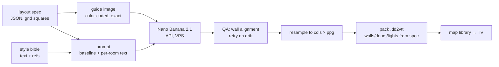

# AI art — vision and the map pipeline

Vision for generated art in battlemap (maps first, then characters, items, effects) and the
design of the first piece: a **fully API-driven map pipeline** on Nano Banana 2.1. Status
2026-10-10: **pipeline v0 built and working** (`tools/mapgen/`, see "built"); prompt v0
untuned; no packed map loaded on a TV yet. Prices and model ids are from Google's own
pricing page and changelog on that date — they churn (see "model churn").

## Principles

- **Everything through the API, everything else on our side.** No web UI, no subscription
  app in the loop. Every step is a script we own, so each step can later get its own UX
  (companion screens) without changing the model side.
- **Our data is the truth, the model only paints.** Geometry (grid, walls, doors, lights)
  comes from a layout we own; the image model never decides where a wall is. That keeps fog,
  doors and room reveal working exactly as with Dungeondraft maps.
- **Heavy work off the TV.** The TV box (2 GB RAM, Mali GPU) only renders. Generation,
  checks, resampling, upscaling and packing run on the VPS (or the Mac for anything that
  wants Apple-silicon compute). The TV receives a finished `.dd2vtt` like any other map.
- **One style bible.** A fixed style text plus 3–5 reference images go with every request,
  so maps, tokens and items look like one world.

## Subscription vs API (verdict)

There is no Claude-Code-like "one subscription with a usage limit" for API use:

| | what it is | images | API? |
|---|---|---|---|
| Google AI Pro (21,99 €/month) | Gemini *app* subscription | ~100 Nano Banana images/day **in the app** | no key; includes **$10/month Google Cloud credit** (Google Developer Program, must be activated) usable on the Gemini API |
| Gemini API (AI Studio key + billing) | pay per image | unlimited, rate-limited per project | yes — **image models have no free tier** |

Nano Banana 2.1 (`gemini-nano-banana-2.1`) per image, standard / batch (batch = async,
half price, results within hours):

| size | standard | batch |
|---|---|---|
| 1K | $0.034 | $0.017 |
| 2K | $0.050 | $0.025 |
| 4K | $0.113 | $0.057 |

A month of map development (drafts at 1K, a few dozen finals at 4K) is roughly **$5–20**.
The $10 credit in AI Pro covers ~200 2K or ~90 4K images. **Recommendation:** for the
pipeline, an AI Studio key with billing and a budget alert is enough; AI Pro only pays off if
the Gemini app is also wanted for hand exploration.

## Built (v0, 2026-10-10)

`tools/mapgen/mapgen.py` (Python 3, Pillow + numpy; runs on the Mac or the VPS):

| command | does | cost |
|---|---|---|
| `guide layouts/<name>.json` | renders the guide PNG only | free |
| `paint layouts/<name>.json --size 1K\|2K\|4K --n N [--thinking …] [--refs …] [--tag …] [--pack]` | guide + prompt → model → QA overlay per image → `meta.json`; `--pack` packs the best | per image, see prices |
| `pack layouts/<name>.json <image> [--ppg N] [--png]` | writes `<name>.dd2vtt` (WebP image, walls/doors/lights from the layout) | free |

Runs land in `tools/mapgen/out/<name>/<timestamp>-<tag>/` (gitignored): `guide.png`,
`prompt.txt`, `out_N.jpg`, `overlay_N.jpg` (our walls cyan, doors red over the painting),
`meta.json` (model, size, QA, token usage, estimated cost). Prompt template:
`tools/mapgen/prompts/baseline.txt`. Sample layouts: `crypt` (16 × 16) and `keep` (32 × 18,
16:9).

**Board:** every test image lives on the horizon board **`battlemap-mapgen`** — guides,
paintings with numbered pins on the features they show (pins in grid squares), the QA
overlays, and blue slots for the next images. Konrad's rule (2026-10-10): **every new image
from this test project goes onto that board**, reorganised as needed — add a plate to
`PLATES` in `tools/mapgen/board.py` (or move a slot out of `NEXT`) and re-run it.

**Account:** API key from 1Password `dev` → **Gemini API - battlemap (Bao billing)**
(`$MAPGEN_OP_ITEM`, or `$GEMINI_API_KEY`). This is Bao's Google account (nico.zingerle),
prepaid €20, no auto-refill — a temporary home: Konrad's own account (ko) has a project + key
(**Gemini API - battlemap**) but no billing yet. Without billing the API answers 429 with
`free_tier_requests, limit: 0`: image models have no free tier.

**Layout spec** — grid units, origin top-left:

```json
{"name": "crypt", "grid": [16, 16], "setting": "an old crypt", "outdoor": false,
 "areas": [{"id": "hall", "rect": [3, 3, 10, 8], "desc": "…"},
           {"id": "pool", "kind": "water", "in": "hall", "rect": [10, 8, 3, 3], "desc": "…"}],
 "doors": [{"x": 7, "y": 11, "side": "n"}],
 "lights": [{"x": 5, "y": 3.3, "range": 4, "color": "ffb060"}],
 "props": [{"rect": [7, 5, 2, 3], "desc": "carved sarcophagus"}]}
```

- Every area is a room; **walls run between different rooms** and between a room and rock.
  Terrain lying inside a room names its host with `"in"` (no walls around it).
- Rooms that share a wall must touch (`rect`s adjacent); a door sits on one side (`n/s/e/w`)
  of a cell on that shared edge.
- `kind`: `floor` (default), `water`, `rubble`, `vegetation`, `solid` (pillars, rock).
  `"outdoor": true` makes uncovered cells open ground instead of rock.

**First results (prompt v0, 1K):** both sample maps keep our geometry almost exactly — walls,
doors, the flooded corner, the corridor all land on the layout (overlay check by eye). The
model paints doors where the red bars are, uses the `desc` text per room, keeps the grid off.
Thinking `high` adds ~2.4k thought tokens (billed as text output, a fraction of a cent) and
~30 s; no visible gain at 1K. 1K gives only 50–64 px per square — finals need 4K.

**Known gaps:** the QA score (edge strength on wall lines ÷ inside rooms, 0.9–1.3 so far)
does not yet separate good from bad — the overlay is the real check; `est_cost` ignores
thought tokens; style refs (`--refs`) untested; no packed map loaded on the TV yet.

## Next — pick up here (hand-off 2026-10-10)

**Start of a session on this sub-project:** read this file, open the board
(`horizon open battlemap-mapgen`, walk: `horizon present battlemap-mapgen overview`), check
the budget (prepaid €20 on Bao's account, ≈ $0.30 used by 2026-10-10 — AI Studio → Ausgaben,
signed in as nico.zingerle). Every new image goes onto the board (rule above).

**Findings from run 1 that set the order** (Konrad, 2026-10-10):

- Doors: the red marker leaks into the art, AND the model draws doors side-on (a door's face
  laid flat), each in another style. Seen from above a door is a thin plank in the wall line.
- Ruin words ("collapsed") make the model open walls our `.dd2vtt` still has.
- The gradient QA score does not rank images; the overlay is the only real check today.

**Steps, in order** (one at a time, each onto the board before the next):

1. **Doors drawn by battlemap, not by the model.** Guide: a door edge becomes a gap (floor
   runs through), no red bar; prompt: "open doorways, no doors". Battlemap draws a top-down
   door sprite on each portal (position + rotation already in the `.dd2vtt`), closed ↔ open
   on toggle — this is also the "door animations" idea in `feature-ideas.md`. One sprite per
   style (Nano Banana once, or drawn in code). Needs a battlemap feature (opt-in, tests), so
   it follows the project's one-feature-at-a-time rule.
2. **Ruins in the layout**, not in free text: an area flag (e.g. `"ruined": true`) that the
   prompt turns into "damage inside the room, every wall stays standing".
3. **Judge.** Script checks in `mapgen.py` (free): red / marker pixels left in door bands,
   painted-wall overlap with our wall lines. Model judge = a **Claude helper session** on the
   subscription (`claude-bridge headless new --cwd ~/code/battlemap`, never `claude -p`): reads
   `guide.png`, `out_N.jpg`, `overlay_N.jpg` and writes `judge_N.json`
   `{walls_kept, doorways_clean, grid_or_text, style_ok, issues: [{x, y, what, severity}]}`
   (x/y in grid squares). Gemini Flash as judge only later, for unattended server runs (a
   "paint" button on the phone).
4. **Board from data:** `board.py` builds plates from each run's `meta.json` + `judge_N.json`
   (issues → pins automatically) instead of the hand-written `PLATES`.
5. **On the TV:** packed crypt on the Android bench (`tools/android_bench.sh`, AVD `bm_tv`):
   do fog, doors and room reveal match the painted walls?
6. **4K finals + the tuning grid** (below), run by the helper session; this session gets a
   short summary + the board.

## Map pipeline



1. **Layout spec** (JSON) — grid size in squares, rooms/corridors as polygons on the grid,
   doors, light sources, terrain areas (water, rubble, vegetation), props, and a short text per
   room ("altar on the north wall, cracked pews"). Sources, in order of build: hand-written →
   Claude/Gemini text model from a description → procedural generator → a layout editor in
   the companion.
2. **Guide image** — rendered from the spec at an exact pixels-per-square, color-coded:

   | color | meaning |
   |---|---|
   | black `#000000` | outside the map, solid rock |
   | mid grey `#808080` | floor |
   | near-black `#202020`, ¼ square thick | walls |
   | red `#FF0000` bar in the wall gap | door |
   | blue `#2060FF` | water |
   | brown `#A07040` | rubble / difficult terrain |
   | green `#30A030` | vegetation |
   | yellow dot `#FFFF00` | light source (brazier, torch) |
   | magenta `#FF00FF` | prop, described in the prompt by grid position |

   Faint grid lines in the guide or none: open question for tuning.
3. **Model call** — guide + style references (≤ 14 images total, ≤ 10 objects for 2.1) +
   prompt. Aspect ratio picked from the grid (16:9 → e.g. 32 × 18 squares fills the TV). Drafts
   at 1K, final at 4K; aim for ≥ ~100 output px per square or detail turns to mush.
4. **QA** — compare the guide's wall mask with the output (dark-edge overlap score); below a
   threshold → retry with a stricter prompt or a new seed. This is what makes "the model only
   paints" safe.
5. **Resample** to exactly `cols × ppg` by `rows × ppg` (the model's sizes are fixed, the grid
   is ours). Optional upscale on the Mac.
6. **Pack `.dd2vtt`** — image (base64), `resolution` (`map_size`, `pixels_per_grid`),
   `line_of_sight` from the spec's walls, `portals` from its doors, `lights` from its lights.
   The TV needs **no change**: it already loads `.dd2vtt`
   (`lib/model/uvtt_map.dart`).
7. **Upload** to the VPS map library through the dev server, like any map.

**Variants on the same geometry** — night, burning, flooded, after the battle: an edit of the
final image (multi-turn, `previous_interaction_id`) with the same guide. Same walls, different
paint. A later battlemap feature can swap the image mid-session and keep fog and doors.

**Big maps** — later: generate in tiles with overlap, the neighbor tile as a reference, blend
seams on our side.

### Prompt baseline v0 (untuned)

```text
Top-down orthographic battle map for a tabletop role-playing game, seen straight down
from directly above: 90 degrees, no perspective, no isometric angle, no horizon.

Repaint the attached layout guide as a finished map. The guide is exact: keep every wall,
door, room and corridor at exactly the same position and size. Do not add, move or remove
walls or openings.

Guide legend: black = solid rock outside the map, render as dark textured stone;
dark grey lines = walls; mid grey = floor; red bars = doors, render as closed wooden
doors set in their wall; blue = water; brown = rubble; green = vegetation;
yellow dots = light sources (braziers, torches); magenta = props described below.

Scale: the map is {cols} by {rows} squares, each square is 5 feet. Size furniture and
objects realistically for that scale: a door is one square wide, a table one by two.

Style: {style_block}
Lighting: even and neutral, soft baked shadows falling to the south-east, no vignette,
contrast high enough to read on a TV in a lit room. Keep floors calm: miniatures stand
on this map.

Do not draw a grid, grid lines, text, labels, numbers, a compass, a frame, a legend,
characters or creatures.

Rooms:
{per-room descriptions with grid coordinates}
```

Default `{style_block}`: "hand-painted fantasy battle map, rich stone and wood textures,
muted earthy palette with warm light pools, crisp readable edges."

### Tuning plan (first session with a key, ~1 € at 1K)

3 layouts (dungeon rooms, outdoor clearing, tavern) × variants, scored by the QA step and by
eye on the TV:

- guide with vs without faint grid
- legend in the prompt vs a legend image as second input
- `thinking_level` minimal / medium / high (2.1 default medium)
- style refs: none vs 3 images
- 16:9 vs 1:1 at the same squares-per-side

Winner becomes baseline v1 in this file.

## UX later (companion)

Describe a map in words → layout spec → editable on the phone grid → "paint" → 1K drafts to
pick from → 4K final → library. Style presets per campaign. Repaint one room: crop + guide
crop → model → feathered paste back (on our side). All of it sits on the pipeline above.

## Beyond maps (vision, not started)

- **Characters, NPCs, enemies** — one reference sheet per character; changes over the
  campaign only by editing the latest version ("same character, add a scar"), never a fresh
  prompt; every version kept with a changelog. Tokens = top-down round crop. Needs
  "custom token images" (`feature-ideas.md`).
- **Movable items** — like tokens, generated on flat `#00FF00` and keyed out (Nano Banana has
  no transparent output).
- **Effect sprites** — image models are bad at frame-consistent sheets. Generate on pure black
  and draw with additive blending in Flame (black vanishes, no alpha needed), animate with
  particles/scale/fade; or a short video clip cut into frames. Feeds "location-triggered
  effects" (`feature-ideas.md`).

## Models considered

| model | why not first |
|---|---|
| Midjourney V8.x | prettiest maps, but no official API → can't sit in a pipeline |
| GPT Image 2 / 2.5 (OpenAI) | strong runner-up; transparent output in API preview — fallback for tokens/items |
| Nano Banana Pro (`gemini-3-pro-image`) | ~2–4× the price of 2.1; try if 2.1 fails the layout QA |
| FLUX.2 (self-host) | needs a GPU we don't have; dev weights non-commercial |
| PixelLab / Retro Diffusion | only for a pixel-art style |
| Leonardo / Scenario | only for training a custom style model |

## Model churn

Google retires image models fast: `gemini-2.5-flash-image` was scheduled to shut down 2026-10-02,
`gemini-3.1-flash-image` deprecated 2026-10-06 in favor of `gemini-nano-banana-2.1`. Keep the
model id in config, never hard-coded; re-check the changelog when a call starts failing.

Sources: [Gemini API pricing](https://ai.google.dev/gemini-api/docs/pricing),
[Gemini API changelog](https://ai.google.dev/gemini-api/docs/changelog),
[image generation docs](https://ai.google.dev/gemini-api/docs/image-generation),
[AI Pro developer perks](https://blog.google/innovation-and-ai/technology/developers-tools/gdp-premium-ai-pro-ultra/),
[Google AI plans](https://one.google.com/about/google-ai-plans/).
