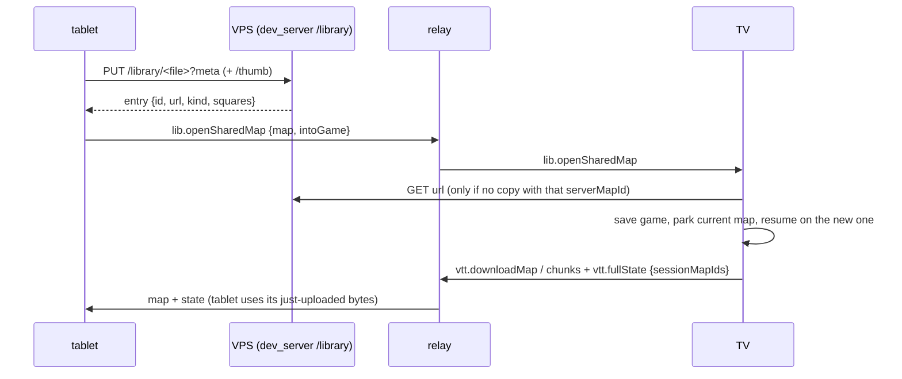

# architecture

## system overview

the app turns a TV (laid flat) into a D&D battlemap. two devices connect through a VPS relay:

```
tablet/phone (apk)      VPS (72.62.88.197)          TV (xiaomi box)
┌──────────────┐        ┌──────────────┐            ┌──────────────┐
│ companion    │──ws────│ vtt_relay.py │────ws──────│ tv shell     │
│ (or web)     │        │ port 9090    │            │ (apk)        │
│              │──http──│ dev_server   │────http────│              │
│              │        │ port 4242    │            │              │
└──────────────┘        └──────────────┘            └──────────────┘
        │                                                   │
        └────── https ──▶  MwLog (VictoriaLogs + Caddy)  ◀───┘
                           srv1189697.hstgr.cloud/p/battlemap
                           (only the APK logs; the web build uses a stub)
```

## data flow

- **commands** flow phone → relay → TV (fog reveal, token place, door toggle, navigation)
- **state** flows TV → relay → phone (fullState broadcast every 50ms when paired)
- **maps** flow phone → VPS HTTP → TV HTTP download (large files bypass the relay); PDFs are rasterized to PNG on the phone first, so the TV only ever loads `.dd2vtt` or images. Since 2026-10-10 every upload goes into the **shared map library** on the VPS (below) and the TV keeps its own copy
- **logs** flow TV and companion (APK, `src=tv` / `src=companion`) and the relay (`src=relay`) → MwLog, our VictoriaLogs tenant `battlemap` on the same VPS (structured JSON lines, basic auth baked in at build time — `docs/setup.md` "logs"; connection drops, outages and late commands: "relay diagnostics" there). The old `log_server.py` is retired (2026-09-05); `/tmp/battlemap.log` on the VPS now only holds the relay's per-message forwards.

## TV storage

the TV stores everything persistently in its app documents directory (on the Apple TV dev target this is purgeable Caches — `docs/apple-tv-dev.md`):

```
Hive boxes (lib/storage/map_library.dart):
  mapIndex     # map library index (MapLibraryEntry JSON per map id)
  mapFiles     # raw map files: .dd2vtt, image or PDF bytes
  sessions     # session state JSON (fog, tokens, drawings, camera, DM layer list)
  thumbnails   # PNG map thumbnails, key map_<id> (made lazily, docs/sessions.md)
```

## games with several maps + the shared map library (since 2026-10-10)

A game (session) holds **several maps** — the tower's floors, the town and the cellar below it —
and the DM switches between them in the companion's **Settings tab ▸ Maps in this game** (tap a
map; "On the table" marks the current one). Each map keeps its own fog, doors, tokens, drawings,
DM layers, ruler, table window and camera; the game's own things (name, session settings, brush,
draw colour, tool) carry over. A switch is a save + resume on the TV (`TvShell._switchMap`,
`Session.switchTo`), so it shows the map exactly like reopening a game; the companion shows
"Loading <map>…" over its map until the new one has arrived.

Maps get into a game two ways, both under the map list:
- **From device** — pick a `.dd2vtt`, picture or PDF (squares dialog as before): it is uploaded into
  the shared library, then joins the game.
- **Shared library** — a sheet listing the VPS's shared maps (thumbnail, squares, size) with
  "Add to game" per map, a delete per map (asks first; TVs keep their copies) and "Upload from
  device" to fill the library without opening the map.

Outside a game the library screen has the same two: **Upload Map / PDF** (into the shared library,
then a new game on it) and **Shared library** ("Play" starts a new game after the session
settings dialog). The TV downloads a shared map once and remembers its id (`serverMapId` on the
library entry), so picking it again reuses the copy.



Code: `lib/model/session.dart` (`mapIds`, `parkedMaps`, `switchTo`, `withoutMap`),
`lib/model/shared_map.dart`, `lib/network/shared_library.dart`, `lib/ui/shared_library_sheet.dart`,
`TvShell._switchMap` / `_openSharedMap`, the Settings tab's `_buildGameMaps`
(`dm_control_panel.dart`); protocol in `relay-protocol.md` "games with several maps" and
"shared map library".

## interaction model

the TV has no touch, no keyboard, no usable remote. the phone controls everything:
- screen navigation (library, game, settings)
- map loading, fog painting, drawing, token placement
- app updates

## interaction modes

single-finger gestures route to the active tool:
- **fog** — drag to reveal/hide fog cells (one `vtt.brushReveal` per cell entered), tap a door to toggle it
- **room** — tap a room to flood-fill reveal/hide it
- **draw** — freehand drawing with color/width
- **token** — tap to place, drag to move
- **measure** — drag to measure (line + distance synced to the TV), tap to clear
- **aoe** — tap places the panel's shape/size; drag aims a cone/line or moves a circle/square

two-finger gestures (any pointer count > 1, detected by pointer count — not by pinch scale)
always control the camera (pinch zoom + pan); the tool only starts on the first single-finger
move, so a late second finger never paints. Scroll wheel zooms (desktop). The ruler, when
visible, is draggable in every mode. Zoom is clamped to `[fit × 0.5, 10]`; the TV's one-inch
scale is its table view (below), not a zoom clamp.

**Phone camera vs TV camera (since 2026-09-06):** the phone's view is independent. The TV
broadcasts its camera *and viewport size*; the phone draws what the players see as a dashed gold
frame (in the table view: exactly the window of whole squares, with a drag grip). The Camera tab
(2026-10-10): **Players see** — "1-inch table" | "Whole map", a line on what the TV shows, the
overview map with the players' window (tap/drag it), arrows that move the window one square;
**Tablet** — "Fit on tablet", "Jump to TV"; **TV** — "TV follows the tablet" (throttled
`vtt.setCamera`), "Show my view on the TV" (in the table view only its centre counts); free zoom
(leaves the table view); rotation.

**DM panel** (`lib/ui/dm_control_panel.dart`): a bottom sheet — tab bar at the bottom edge
(thumb reach), content above it, tap the active tab to collapse. On a **landscape tablet**
(`DmControlPanel.sideLayoutFor`: wider than tall, shortest side ≥ 600 dp) it docks at the right
edge instead: a 72 px tab rail with undo/redo at its foot, the tab content (320 px) unfolding to
its left; the map takes the rest of the row. ≥ 44 px targets, 14 px text. Sliders (draw width,
scale, layer opacity) preview locally and send on release. Bulk buttons (Reveal all, Hide all, Clear drawings)
confirm with a snackbar that offers Undo (`vtt.undo`).

**Full screen (Android, since 2026-10-10):** during a game the companion hides Android's status
and navigation bars (sticky immersive, `SystemBars` in `lib/ui/system_bars.dart`); a swipe in
from the bottom edge shows them for a few seconds, the side-swipe back gesture keeps working.
The button at the map's top right toggles it, stored on the device (Hive box
`companionSettings`, default on); library and waiting screens keep the bars. The TV hides them
for the whole run.

**Tabs are modes (since 2026-10-10):** being on a tab is its interaction mode, there are no
mode buttons inside the tabs. **Tokens** (leftmost, the normal mode: tap an empty square places a
token, drag moves it, tap a door opens/closes it; the list below), **Fog** (its
tool Brush | Room | Circle, remembered), **Draw**, **Measure**, **Combat** (AoE templates, digital play
only); Layers, Camera and Settings use the Tokens mode. Switching tabs sends `vtt.setMode`;
tapping the active tab only folds it, the mode stays. A mode set elsewhere (the TV restoring a
game, the bench robot) switches the panel to the tab that owns it — not within 1.5 s of the
panel's own request, while the TV's echo is on its way. Tokens are always on now: they remember
where the miniatures and monsters stand (`SessionSettings.tokens` is legacy, no longer shown).
New games start in the Tokens mode.

**Tokens tab (since 2026-10-10, 1.1.12):** a name field + add button creates a token that is
not on the map yet (`vtt.createToken`, `MapToken.placed` = false). Each row: coloured dot with
its number, name (tap → rename dialog), where it is ("On the map" / "Not on the map", "hidden from
players"), and buttons — **place** (not on the map: arms it, `VttState.placingTokenId`, local to
the tablet; the next tap on an empty square puts it there via `vtt.moveToken`; leaving the tab
cancels) or **jump** (on the map: centres the tablet's own view on it, `VttGame.centerOnSquare`,
the TV stays), **eye** (hide from the players / show, `vtt.setTokenHidden`: the TV leaves it out,
the tablet draws it faded) and **delete** (one tap, snackbar with Undo).

**Fog tab:** Tool = Brush | Room | Circle (the interaction mode), Reveal | Hide, brush size
(brush only) or radius in squares (circle only, − n +, 1–30, default 4), "Players see changes: Instantly | Preview first" (shadow mode; staged squares are
applied or discarded under it), fog layer, reveal all / hide all. The preview's tint (blue = will
be revealed, red = will be hidden) shows on the tablet only; the TV draws staged squares as plain
fog until they are applied (`FogOfWarComponent.showPreview`, off when `tableDisplay`).

**Circle reveal (since 2026-10-10):** a tap reveals (or hides) the squares within the radius of
the tapped square that can be reached from it without crossing a wall or a closed door
(`WallGrid.floodFillWithin`: flood fill that only steps onto squares inside the circle, same
round shape as the brush, `dc² + dr² ≤ r² + r`). So it stops at the room's walls; an open door
inside the circle lets it through. A map without walls (picture maps) gets the plain circle. A
door tap still opens/closes the door. The tablet works out the squares and sends them like a
room (`vtt.roomReveal`), so "Preview first" stages them for the DM to correct before applying.
The radius is local to the tablet (`VttState.revealRadius`, not synced or saved).
In the preview the last circle stays **live**: − / + on the radius redraws it in place
(`VttState.previewCircle` keeps the preview from before the circle and swaps the circle), until
it is applied, discarded, or another fog change, a new circle or leaving the preview ends it
(`liveCircleCell`). Without the preview a circle is revealed at once and the radius only
affects the next tap.

**Ruler:** shown via `vtt.toggleRuler`, the TV places it in the middle of its own view, square
to its screen (`VttGame.centerRulerInView`); rotating turns it around the middle of the L
(`VttState.rotateRulerCW`); its numbers stay upright on every screen (`RulerComponent.labelAngle`
undoes ruler + camera rotation).

**Template disc (since 2026-10-10):** the acrylic AoE template disc, rebuilt — Measure tab ▸
Template disc. Classic look (`TemplateDisc.classic`): red 5/10/15/20 ft radius rings, black dotted
10/20/30 ft cubes centred on the middle, blue dotted 15/30 ft 5e cones (as wide as long) on one
shared base line (the 30 ft cone centred, the 15 ft cone's tip on the middle), label pills, 12
compass marks between the two largest rings (the one under the ring labels left out), a
one-square circle in the middle, a clear edge just outside the farthest outline. One square = 5 ft,
so on the table it is the physical disc's size. Everything is configurable and applies at once
(the panel's **Shape** unfolds in place): per family (rings, cubes, cones) shown or not, sizes in
feet (tap a size for − / + / remove, + adds the next 5 ft), colour, solid/dotted, labels; cone
tips on one base or from the middle, cone width 5e/60°/90°; middle circle, edge, compass marks
0/4/8/12, tint, line and label size; the middle snaps free / to square middles / to corners;
"Back to the classic disc". The look is remembered on the tablet (Hive box `templateDisc`) and
laid on the game's disc when it is shown; the TV centres a shown disc in its view
(`VttGame.centerTemplateDiscInView`). On the map, in every tab: drag its middle or its edge to
move it, the gold knob on the edge (tablet only, on the cones' open side) to turn and aim it
(whole degrees, sticks to 45° steps within 4°); a token under the finger in the Tokens tab wins
over the middle. Rendered by `TemplateDiscComponent` (priority 22, outlines and labels cached
per look, labels flip instead of reading upside down). State: `VttState.templateDisc`, synced
with `vtt.setTemplateDisc`; the tablet ignores the TV's echo for 1.5 s after its own change so a
drag does not jump back. Saved per map (`Session.templateDisc`, a per-map key).

**DM layers (since 2026-10-10):** the Layers tab adds any number of pictures (PNG/JPG/WebP, PDF
page 1) that only the DM sees — a DM version of the map, notes, secrets. Each layer has an eye,
an opacity slider, up/down and delete (undo snackbar); a master eye hides them all on this
device. Pictures go phone → VPS (`uploads/dm/`, kept); the list (`DmOverlay`, metadata only)
lives in the TV's session and comes back in `vtt.fullState`. Only the phone's `VttGame` gets a
`DmOverlayImages` cache (download, decode ≤ 4096 px while visible, free when hidden), so only
the phone has a `DmOverlayComponent` — the TV cannot draw a layer whatever its state says.

## table view — one square = one inch (since 2026-10-10)

The TV lies flat under real miniatures on 1-inch bases, so **every map is shown at one map
square = one physical inch**. Measured on Konrad's TV (2026-10-10): **34 × 19 one-inch squares
fit, with a bit of gap both ways** — that is the optimal result for every map: a window of
34 × 19 whole squares, centred, the leftover split evenly on both sides and masked dark, never a
cut square at the screen's edge.

- **Calibration belongs to the TV**, not to a game: the physical width of its picture
  (`VttState.tvWidthInches`, Hive box `tvSettings` on the TV, `TvCalibrationStore`). Default
  34.5 in = 34 × 19 squares with about ¼ in to spare per side. Companion ▸ Settings ▸ Table scale
  ▸ "Measure the TV…": the TV shows its one-inch squares and a 10-inch bar
  (`TableFrameComponent`, `vtt.showCalibration`); the DM types what the bar measures (cm or in),
  or sets the picture width with a stepper (±1 / 2 / 5 / 10 mm or ±0.05–0.5 in, tap the number
  for a numpad); each change applies at once (`vtt.calibrate`). This is the **TV's** scale (an
  inch on this screen), set once per TV; how many squares a map has is the **map's** scale (upload
  dialog, grid editor — below), stored with the map. Before
  1.1.9 each session carried its own `tvWidthInches`/`calibratedBaseZoom` and a 0.5–2× scale
  slider — both gone (the slider broke the one-inch rule).
- **Arithmetic** (`lib/model/table_fit.dart`, pure, tested): `TableGrid` = whole squares of the
  screen (`cols = ⌊width / ppi⌋`) and the centred window; `TableLayout` = camera for a map:
  zoom `ppi / cellPx`; per axis, a map that fits is centred, a bigger one shows the window from
  square `col`/`row` (clamped, whole squares). Turned 90°/270° the screen's 34 columns run down
  the map. The phone rebuilds the same layout from the TV's camera snapshot (`vw`, `vh`, angle)
  and the synced state (`VttGame.tvTableLayout`).
- **Camera modes** (`TvCameraMode`, synced + saved): `table` (default, also for older sessions),
  `fit` (whole map for the players — squares not one inch), `free` (+/− zoom, or a view sent
  outside the table view). The TV's `VttGame(tableDisplay: true)` lays out the camera on every
  state change, resize and map load; rotation keeps the window's centre.
- **Panning a big map**: the TV keeps the window start (`tableCol`/`tableRow`, `null` = centred
  on an axis where the map fits). The tablet moves it with the frame's grip on the map, the
  overview map in the Camera tab (`TvOverviewMap`, the game's own decoded picture), or arrows
  (`vtt.setTableWindow`, `vtt.panTable`). A drag previews on the tablet at once, sends throttled
  (80 ms), and the preview yields once the TV shows that window.
- **Per game and per map**: the session file records the map's scale (`mapFit`: map px per
  square, the TV zoom for one inch, the calibration, the table size, whether the whole map fits,
  whether battlemap draws its grid — `MapFit`), plus mode and window. Whether battlemap draws its
  grid is also remembered on the map (`MapLibraryEntry.drawGrid`, set by the upload dialog's
  "the picture has its own grid lines" and by every grid toggle), so the next game on the map
  starts the same way. Picture/PDF maps can be re-gridded in a game (Settings ▸ Grid ▸
  "Fit the grid on the picture" or "Map squares", `vtt.setMapGrid`; keeps drawings, tokens, layers, and the
  fog too when the counts stay — see "picture grid").
- **Upload dialog** for picture/PDF maps (`showMapGridDialog`): the picture's size, squares
  across and down as steppers (rows follow for square squares), a warning when squares come out
  > 3 % off square, and how the map sits on the table (fits / fits turned / the TV pans). A
  picture with no grid drawn in says so and offers "Measure on the picture" (the grid editor's
  Known length tool) instead of "Fit on the picture".

**Number stepper** (`NumberStepper`, `lib/ui/number_stepper.dart`, since 2026-10-10): the one
control for every count and length in these dialogs, after MitWare's — `−10 −5 −2 −1 [ n ] +1 +2
+5 +10` (the steps vary: 0.01–5 px for a square size, 1–10 mm for the TV), the biggest steps
dropped where the row is too narrow, and a tap on the number opens a numpad (`showNumpad`; first
key replaces, out-of-range keeps OK off, a hardware keyboard works too). Gotcha: the stepper
measures its room with a `LayoutBuilder`, which cannot answer `AlertDialog`'s intrinsic-width
query — a dialog holding one gives its content a fixed width (`SizedBox`), or it throws.

## embedded grid detection (since 2026-10-10)

Many published maps have their grid drawn into the picture. Before the upload dialog the
companion looks for it (`detectGridInPicture` in `lib/model/grid_detect.dart`, ≤ 0.2 s): a found
grid pre-fills columns × rows, ticks "the picture has its own grid lines" (battlemap then draws
none) and shows a green "Found a drawn grid: 40 × 30 squares of 32 px". A grid that does not
start at the picture's edge becomes a **picture grid** (below) — nothing is cropped. Nothing
found → the **file name** is read for the squares (`gridCountsFromName`: `Tavern_30x40.jpg`,
`[22 x 30]`; only counts that give square squares of ≥ 20 px on this picture, either order),
else 20 across; the box stays unticked and the dialog offers "Measure on the picture" — the grid
editor in its Known length tool, because a map with no squares to count gets its scale from
something of known size. With a grid, "Fit on the picture" opens the editor as before.

The formula, per axis (x shown; rows are the same), on the picture averaged down to ≤ 3072 px:

| Step | What | Why |
|---|---|---|
| 1 profile | `P(x) = Σ_y min(\|L(x+1,y) − L(x,y)\|, 24)` on luminance (transparent = white) | grid lines run the whole height, so their columns add up; the clip keeps walls from drowning faint lines |
| 2 clean | minus a 15-sample moving average, then a `[1 2 3 2 1]` blur | only sharp peaks stay; thick and thin lines overlap when shifted |
| 3 period | autocorrelation `A(l) = Σ P(x)P(x+l) / Σ P²`: strongest peak for `l` ∈ [20 px, size/3], then its smallest fraction `l/d` (d = 2…6) still ≥ half as strong; sub-pixel via a parabola and the peak at `k·l` | `A` peaks at the spacing and its multiples; walls or major lines every 2–5 squares must not win; a strong fraction under 20 px = texture (bricks) → no grid |
| 4 agree | both axes within 3 %, both strengths ≥ 0.25 | random texture practically never agrees on both axes |
| 5 phase | `arg Σ P(x)·e^{2πi·x/cell}` → where the lines sit | the picture grid's position (`GridDetection.toRasterGrid`) |

Validated: Juri's cave map (40 × 30 of 32 px, strength 0.96), all `.dd2vtt` test-map pictures
(72 / 150 px, 0.38–0.65), Dyson's 6000 px tavern (240 px dashed grey lines, needed 3072 not 2048),
Juri's photographed page (52 px, drifting); no grid reported on the AI pipeline's
pictures (their 12 px stone texture fooled the first version) or the gridless small home.
`test/grid_detect_test.dart` covers it with synthetic pictures (the real maps are gitignored).

## picture grid and grid editor (since 2026-10-10)

A picture/PDF map's squares are a `RasterGrid` (`lib/model/raster_grid.dart`): the top-left
corner of square (0, 0) in picture px (`x`, `y`, may be negative), the square's width and height
(`cellW`, `cellH`, sub-pixel), `cols × rows`, and the picture size they refer to. The game maps
the grid's rectangle onto the map's squares (`VttMapImageComponent`, also the DM layers and the
tablet's overview map), so nothing is cropped or resampled: a grid starting inside the picture
just leaves the sliver off the table, "partial edge squares" reach past the picture (dark there),
and non-square squares of a photographed page come out square. Without a grid the counts stretch
over the whole picture (`RasterGrid.whole`, every map before). The map's own px per square =
`round(cellW)`. Stored on the library entry (`MapLibraryEntry.rasterGrid`), sent in
`vtt.imageUploaded` / `vtt.setMapGrid` (`grid`) and `vtt.fullState` (`rasterGrid`); a PDF
rendered at another size scales it (`forPicture`).

**Grid editor** (`showGridEditor`, `lib/ui/grid_editor.dart`, companion, full screen): the picture
with battlemap's grid drawn over it (outside dimmed), zoomable, a side panel on a landscape
tablet, below on portrait. Corrects what detection got wrong — or fits a gridless picture:

| Control | What it does | Precision |
|---|---|---|
| Look / Move grid / Stretch / 2 corners | one finger pans / slides the grid / stretches it (top-left corner stays, the line under the finger follows) / marks two grid corners; **two fingers always move the view** | magnifier (4×, crosshair) while dragging |
| Known length (no grid in the picture) | drag/tap a line over something of known size — a door (1 square), a 10 ft corridor, a scale bar — and say its length in squares or feet (5 ft per square), "Use this length": square squares of `length ÷ squares`, grid lines through the line's start (`RasterGrid.fromLength`) | a mark's error ÷ the squares; a long line (a room, a scale bar) beats a door |
| 2 corners | mark a corner, mark a far one, check "squares across / down" (auto-counted as the pair both directions agree on, ±; with square squares down follows across; the implied size shown, a warning past 1 % disagreement), "Use these corners" | a mark's error ÷ the count: 1 px over 30 squares = 0.03 px |
| Square size | number stepper ±.01 / .1 / 1 / 5 px, tap the number for a numpad; "Square squares" off → width and height rows | 0.01 px |
| Position | arrows by 1 px or 0.1 px, x/y (tap to type), "lines on the picture edge" | 0.1 px |
| ½ size, × 2 size, squares across (stepper ±1/2/5/10), whole only / include partial | the detector's typical errors (half/double), the old fill-the-width count | — |
| Check the fit | zoom to top left / right, centre, bottom left / right, whole picture | drift shows at the far corner |
| Undo, redo, back to the start, detect again, detected | — | — |

**Fingers:** one touch = first finger down to last finger up; only a one-finger touch edits —
when a second finger lands, what the first did is undone and the touch only moves the view
(the scale recogniser restarts per finger, so the editor counts fingers itself). The magnifier
shows ~1.5 squares, marks left out. Re-gridding the same picture keeps the tablet's view.
Keyboard: arrows nudge (Shift 10×), + / − size by 0.01. The readout shows counts, square size,
how the map sits on the table, skew of non-square squares. Opened from the upload dialog ("Fit on
the picture", or "Measure on the picture" in Known length for a gridless picture) and in a game
(Settings tab ▸ Grid ▸ "Fit the grid on the picture"; on a map battlemap draws the grid over,
"Set this map's scale on the picture", opening in Known length). In a game a fine
adjustment with **the same counts keeps the fog**, shadow edits, the table window and undo
(`VttState.regridRaster`); new counts clear them.

## rendering order (flame engine)

| priority | component | description |
|----------|-----------|-------------|
| 0 | map image | .dd2vtt image, uploaded PNG/JPG, or a PDF page rasterized on the phone |
| 1 | grid overlay | grid lines |
| 2 | strokes | completed drawings |
| 3 | live stroke | in-progress stroke preview |
| 4 | token layer | colored numbered circles |
| 5 | walls | DM debug lines |
| 6 | portals | door markers — DM tablet only, the TV shows the map's painted doors (`PortalComponent.showMarker`); on maps with `draw_doors` (AI maps) a top-down door leaf that swings open, on every screen — on the TV at priority 11, **above the fog**, drawn only while the fog is off or a square beside the doorway is revealed (`PortalComponent.forPlayers`), so a door opened into a fogged room stays visible and doors deep in the fog give nothing away |
| 10 | fog of war | dark overlay with reveal cutouts (opaque on the TV, 70 % on the phone) |
| 12 | DM layers | **phone only**: DM-only pictures, each with eye + opacity, fitted into the map (aspect kept, centered); above the fog so secrets stay readable |
| 28 | TV frame | **phone only**: what the players see — the table window (with a drag grip when the TV can pan) or the TV's screen rectangle (`TvViewportComponent`) |
| viewport | table frame | **TV only**, screen space: masks the leftover around the window of whole squares; the calibration pattern (`TableFrameComponent`) |
