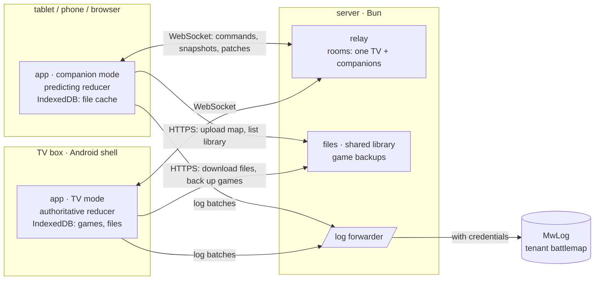
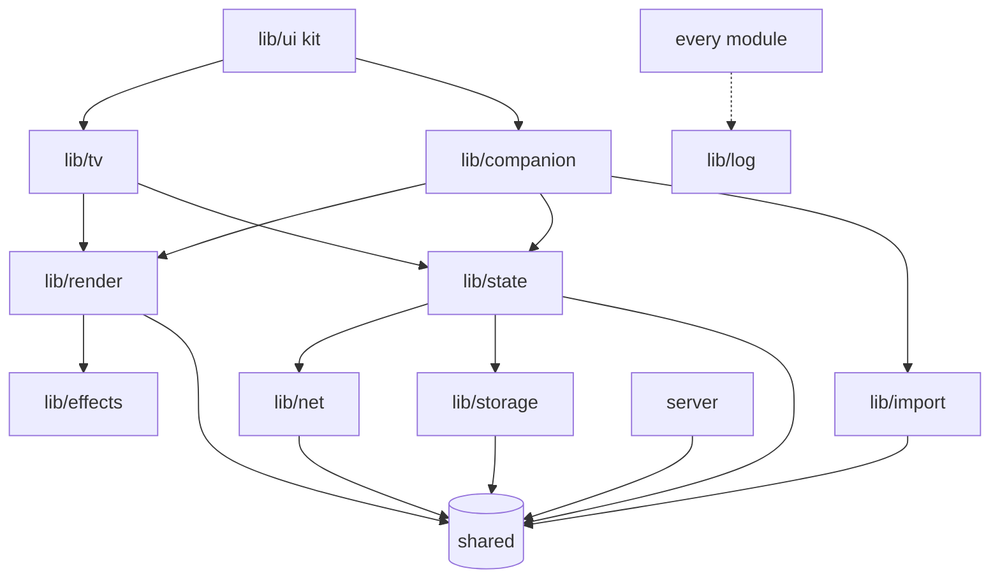
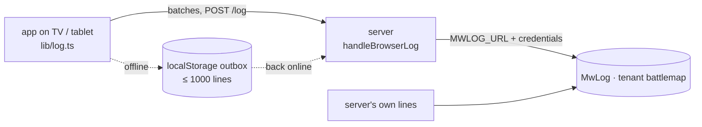

# battlemap v2 — architecture

battlemap turns a TV lying flat into a D&D battlemap under real miniatures; the DM drives it
from a tablet. v2 is the same product rebuilt on web tech: one Svelte + TypeScript bundle with a
WebGL table renderer, run by a thin Android shell on the TV box and on tablets/phones, and by any
browser. This file is the map of how it fits together and why. The message catalogue is in
[`protocol.md`](protocol.md); the old app's docs (`../../docs/`) stay the product specification.

Five rules carry the design:

1. **The TV is the table and the authority.** It holds the game, applies every change, saves it.
2. **One pure reducer** in `shared/` — `apply(state, command)` — runs on the TV for real and on
   the companion as a prediction. Same code, same result.
3. **The server is dumb on purpose**: it relays messages between a TV and its companions, stores
   files, keeps a backup of every game, forwards logs. It never interprets a game.
4. **Units are squares.** Every position in the game state is in map squares, never in pixels
   of some device's texture.
5. **Nothing renders unless something changed.** The TV box is the performance floor.

## Platforms

| Where | Runs | Constraints that shape the code |
|---|---|---|
| TV box — Xiaomi TV Box S 3rd gen (Google TV), also Fire TV | the app in TV mode, inside the Android shell's WebView | Mali-G310 (~42 GFLOPS), **2 GB RAM**, 4K output; WebGL2 (GLES 3.2); input is a D-pad remote only, as a fallback — the tablet drives everything |
| Android tablet / phone | the app in companion mode, same shell | touch, pinch; sleeps and drops sockets (the old tablet did) |
| Browsers — Safari on iPhone, desktop Chrome/Firefox | the same bundle, companion (or TV mode in a tab for development) | Safari's WebGL2 and IndexedDB quirks; may run on plain http in LAN play |
| Server — Bun on the VPS (dev: on the Mac) | relay, files, shared map library, game backups, `/log` | holds the only secrets (MwLog credentials); behind Caddy's HTTPS in production |

**The Android shell** (`shell/`, [`shell.md`](shell.md), typed bridge `shell/bridge.d.ts`) serves
the bundle from its own secure origin, `https://appassets.androidplatform.net/app/` (built in, or a
downloaded bundle) — so the app is **built for the base `/app/`**, and the server serves it under
`/app/` too. The contract, wrapped by `app/src/lib/shell.ts` (a no-op in a plain browser):

- **Start parameters:** `index.html?mode=tv|companion&device=<stable id>[&server=…]`. Without
  them (a browser tab) `lib/config.ts` falls back to the bridge's `info()`, then to what the
  device remembered, then to the start picker and the page's own origin as the server.
- **`ready()`** once the app has mounted — a downloaded bundle that loads three times without it
  is dropped for the built-in one.
- **Shell logs:** `takeLogs()` and the live `log` events go into the app's logger (area
  `shell`), so the shell's own lines reach MwLog the same way.
- **Events:** `back` (call `preventDefault()` when the app handled it), `memory` (Android wants
  memory back: the renderer drops textures it can rebuild), `bundle` / `apk` progress.
- **Developer settings** from the app: `setServerUrl`, `setStartMode`, `setDevUrl`.

The app must also work in an insecure context (LAN play over http): clipboard paste, service
worker and persistent storage are then simply off.

## System overview



Small JSON messages travel over the relay; anything big (a map picture, a DM layer, a game
backup) goes over HTTP by content hash. Later a **direct LAN path** replaces the relay: the TV's
shell hosts the same WebSocket endpoint and the companion connects to the TV's address — the
messages do not change (see "networking").

## Module map

```
v2/
  shared/   protocol + game model + reducer + pure geometry   (no DOM, no Node — imported by app and server)
  app/      the one web app: TV mode and companion mode
    src/lib/log.ts        the logger (mwlog-ts browser forwarder → the server's /log)
    src/lib/log-outbox.ts undelivered log batches kept in localStorage, sent later
    src/lib/config.ts     server URL, mode, device and table ids (URL → shell → remembered)
    src/lib/shell.ts      the Android shell's bridge, typed, a no-op in browsers
    src/lib/net/          connection: WebSocket, reconnect, heartbeat, offline policy
    src/lib/state/        host.ts (TV), client.ts (companion), sessions.svelte.ts (runes)
    src/lib/render/       PixiJS: bootstrap, render-on-demand, the table scene, view profiles
    src/lib/tv/           TV mode screens (start, waiting, library, game, calibration pattern)
    src/lib/companion/    companion screens, panels, tools, gesture input
    src/lib/storage/      IndexedDB: games, table settings, file cache
    src/lib/import/       .dd2vtt, PDF (pdf.js), pictures, grid detection, WebP, table copies
    src/lib/effects/      effects runtime: registry, anchors, layer slots
    src/lib/ui/           the fluent component kit (tokens, components, the notice store; no game logic)
  server/   relay rooms, static app, files, library, backups, link fetch, /log
  shell/    Android WebView shell (TV + tablet), its bridge types in shell/bridge.d.ts
  assets/   effects library and other shipped art, with manifest + licences
  e2e/      Playwright flows across a TV page and a companion page
```



Arrows point at what a module may import. `lib/ui` knows nothing of games; `lib/render` knows
nothing of Svelte (it takes state, draws it); `shared/` imports nothing but valibot.

## State: what exists and who owns it

There is one replicated state tree, `RootState` (types in `shared/src/model/`):

| Part | Holds | Saved where |
|---|---|---|
| `table` | the TV's calibration (picture width in inches, overscan %), its viewport size, the calibration pattern (on, pivot) | the TV (settings store), not in games |
| `view` | `library` or `game` — what the TV shows | — |
| `game` | the open game: id, name, settings, the maps in the game in order, the active map, and per map its **play state**: fog (revealed mask, staged preview), open doors, tokens, drawings, DM layers, ruler, template disc, effects, how the TV frames it (table window, mode, rotation, free camera), grid on/off | the TV (IndexedDB), backed up to the server |
| `live` | things that are shown but never saved: the measure line, a stroke being drawn, the last one-shot effects | — |
| `history` | undo / redo stacks (50 steps, one step per gesture) | memory only, like the old app |

What is **not** in it is device-local and never synced: the companion's tool and tab, brush
size, reveal-or-hide choice, draw colour and width, its own camera, the master eye for DM layers,
the walls debug view. The old protocol synced these (`vtt.setMode`, `vtt.setBrushRadius`, …)
only because the TV interpreted input; in v2 commands carry explicit values instead
(`fog.apply` says `reveal` or `hide` and lists the squares).

### The reducer

`apply(state, command) → { ok: true, state } | { ok: false, reason }` in `shared/src/reducer/`.
Pure and deterministic: no clock, no randomness, no IO — ids, names and timestamps come inside
the command, made by whoever issued it. It never mutates; unchanged branches are shared, so
"did the fog change?" is a reference check. Every command type is handled in one exhaustive
`switch` (the compiler fails on a new type without a handler). A rejected command changes
nothing and says why ("no map on the table", "unknown token").

### Who is authoritative — the TV

The TV applies commands for real, numbers them, persists the result. Considered and rejected:
the **server as authority** (it would need the game logic, become the single point of failure,
and make play without internet impossible — the LAN path has no server) and **peer-to-peer
merge** (CRDTs: heavy machinery for a game with one DM). The TV is also the only place the
table's own facts live (its calibration, its viewport), and it is the device that must keep
showing the game when the network drops. This is the old app's model, which worked; v2 keeps
it and removes its sync hacks.

### Sync: commands, patches, snapshots

```mermaid
sequenceDiagram
  participant C as companion
  participant R as relay
  participant TV
  C->>C: apply(cmd) to its prediction — instant feedback
  C->>R: sync.cmd {seq: 7, cmd}
  R->>TV: sync.cmd (from: C)
  TV->>TV: apply → rev 41, mark dirty (save in 2 s)
  TV->>R: sync.applied {epoch, rev: 41, by: C, seq: 7, cmd}
  R->>C: sync.applied (to every companion)
  C->>C: confirmed := apply(confirmed, cmd); drop pending 7; prediction := confirmed + pending
  Note over C,TV: a gap in rev, a new epoch or a (re)connect → sync.request → sync.snapshot {epoch, rev, state, acks}
```

- **Patches are the commands themselves.** The TV broadcasts each command it accepted with the
  new revision; since the reducer is deterministic, every companion that applies the same
  commands in the same order holds the same state. Cheap, exact, easy to log.
- **Snapshots** (the whole `RootState`) go to a companion when it joins, when it sees a gap
  (`rev` not `last + 1`), or when the TV changes `epoch` — a new random id whenever the TV opens
  another game or restarts. A snapshot carries `acks`: per client, the last command `seq` the TV
  applied, so a reconnecting companion knows which of its pending commands made it.
- **Prediction.** The companion keeps `confirmed` (what the TV said) and `pending` (its own
  commands not yet echoed); what it shows is `pending` folded onto `confirmed`. An echo removes
  the command from `pending`; a `sync.rejected` removes it and shows a notice. This replaces the
  old guards — "ignore the TV's echo for 1.5 s after a drag", the DM-layer `rev`, "don't switch
  tabs within 1.5 s of my own request": a stale broadcast can no longer flash an old value back,
  because the prediction is rebuilt from the confirmed state plus what is still in flight.
- **The TV's own actions** (a remote key, its viewport size) are commands too, issued by the TV
  to its own host, numbered and broadcast like any other.
- **Requests** need IO on the TV and are not reducer commands: open, start, close, delete or
  rename a game, list the games, diagnostics, prepare for a deploy. The TV answers with a
  message (`lib.listing`, `diag.report`, …) and, for anything that loads a game, a new snapshot.
  While it loads it broadcasts `tv.status {busy: "Loading the tower…"}`, so the tablet shows the
  same progress the TV does.

### Offline policy (lessons of the old relay diagnostics)

- A command made **while not connected** (or while the TV is away) is not applied and not
  queued: the companion shows "Not connected to the TV — that wasn't sent" and logs it. The old
  app replayed such taps late, all at once (fixed in 1.1.15); v2 never does.
- Commands **in flight** when the connection drops: on reconnect the snapshot's `acks` tells
  which arrived; the rest are dropped with one notice, never resent.
- Undo is per gesture: a brush stroke, a room fill, a drag is one step (`gesture` id in the
  command), not one step per square as before.

## Networking

The protocol is transport-agnostic: JSON messages over any WebSocket endpoint that implements
the small server part (`hello`/`welcome`, routing, `ping`/`pong`). Today that endpoint is the
server's `/ws`; for LAN play the TV's shell will host a one-room version of it.

- **Rooms.** A room is one table: one TV slot and any number of companions. The TV picks a
  persistent `tableId` (the shell's device id, else a random id it keeps) and joins that room;
  `GET /api/tables` lists the rooms with a TV online, so the companion offers them and remembers
  the last. A second TV in the same room takes the slot and the old one gets `replaced` and stops
  reconnecting (shows "Another TV took over" with a focused "Take over" button). The same device
  reconnecting just replaces its own dead socket, silently. Several companions are fine (two DMs,
  a test bot).
- **Routing** (the server's whole job): a companion's message goes to the room's TV; a TV's
  message goes to every companion, or to one when it names `to`. The server stamps `from`. A
  message for a TV that isn't there comes back as `relay.undelivered`.
- **Heartbeat and reconnect.** The client pings every 15 s and the server answers (`rtt`
  logged; over 1 s is a warning). No data for 35 s, or no `welcome` within 8 s of opening →
  force a reconnect. Backoff 1, 2, 3, then 5 s. Reconnect at once when the page becomes visible
  again or the network comes back. Every message carries `sent` (sender's clock); a peer message
  older than 1.5 s on arrival is logged as late.
- **What every side logs** (area `net`): connecting, socket open (`connectMs`), welcomed
  (`outageMs`), connection lost (`closeCode`, `upS`, `lastDataAgoMs`), forcing reconnect
  (`reason`), reconnect scheduled (`delayS`), dropped while offline (`count`, `types`), late
  messages, slow round trips, event-loop stalls (a timer more than 1 s late), page hidden/shown.
  The server logs joins, leaves (`closeCode`, `upS`), takeovers, undelivered messages and a
  per-minute traffic summary per room. Same questions as `../../docs/setup.md` "relay
  diagnostics" answer from the same kind of lines.

## Persistence

**On devices: IndexedDB** (one database `battlemap`, `lib/storage/`): `games` (full game state,
structured clone), `settings` (the TV's calibration, the companion's remembered look of the
template disc, Store-as choice, …), `files` (picture and geometry blobs by content hash — a
cache, refilled from the server). Small preferences (mode, last table) in `localStorage`. The TV
asks for persistent storage when the context allows it.

- **Save cadence (TV):** 2 s after the last change to saved state (`live` changes don't count);
  flushed at once before opening another game, closing, a deploy reload, and when the page hides.
  After each local save the TV sends the game to the server backup (latest wins; retried when
  back online).
- **Start:** the TV reopens the game it had open (the same mechanism replaces the old deploy
  "restore" route: every start restores).
- **Box reset:** a fresh TV lists the server's backups next to its own games; opening one
  downloads it and its files. Nothing is lost but undo history.

**On the server** (`DATA_DIR`): `files/<hash>.<ext>` (immutable, content-addressed, served with
`Cache-Control: immutable`), `library.json` (the shared map library), `games/<gameId>.json` (the
latest backup, plus the previous ten), `uploads/` (temporary, link fetches; 7-day cleanup).

**Files and maps.** A `FileRef` is `{hash, ext, bytes}`; its URL is `<server>/files/<hash>.<ext>`.
Uploads go `POST /files` (the server hashes, optionally converts — WebP / JPEG / PNG as the old
"Store as" — and answers the ref). A map in a game is a `MapInfo`: name, squares (`cols × rows`),
the picture grid (`RasterGrid`: where the squares lie on the picture), whether battlemap draws
the grid, door count, and file refs. A `.dd2vtt` is split at import into its picture and a small
**geometry** file (walls, doors, lights in squares) — the TV never parses a 30 MB JSON with a
base64 image inside. Big pictures also get a **table copy** at import (≤ 72 px per square, WebP)
that the TV loads instead of the original; the companion zooms in and uses the original.

## Rendering

**PixiJS v8 on WebGL2.** Considered: raw WebGL2 (we would rewrite batching, text, render
textures, hit areas — months of work Pixi already has), Canvas 2D (fill-rate bound on the CPU at
1080p — the fog blur alone would sink the box), Three.js (a 3D engine for a 2D scene, bigger).
Pixi v8 batches sprites and graphics, renders to textures, has a WebGPU path for later, and lets
us own the loop: `autoStart: false`, we call `render()` only when something changed.

- **Render on demand.** `lib/render/scheduler.ts`: `invalidate()` asks for one frame (coalesced
  into the next animation frame); something that animates (an effect, a door swinging, the fog
  fading) holds a lease and the loop runs until the last lease ends. Idle = zero frames.
- **Resolution.** The TV renders at most 1920 × 1080 backing pixels and lets the compositor
  scale to 4K; the companion at its device pixel ratio, capped at 2.
- **Textures** ≤ 4096 px a side (2048 on the TV for upload smoothness); bigger pictures are cut
  into tiles. The TV decodes a map at the density the table needs (its px per inch — ~56 px per
  square at 1080p) via `createImageBitmap` with a resize, within a 128 MB map budget (lower
  density if needed, never below 32 px per square); textures are destroyed when a map leaves the
  table. Fog, tokens and effects share a 32 MB budget.
- **Fog** is a mask texture with **one texel per square** (R8), uploaded whole when the mask
  changes (a 200 × 200 map is 40 KB), and drawn by one fragment shader over the map: opaque on
  the TV, 70 % on the DM's view, staged squares tinted blue/red on the DM's view only. The shader
  does the fog styles (standard, soft, cloud, atmospheric), "trim revealed edges" (neighbour
  lookups, the old `fogRevealRects` rule) and the reveal animation (G channel = fog still to go, staggered
  by `reveal-anim.ts`; on the TV at full effects quality a noise dissolve with smoke wisps, else a plain fade).
  One full-screen quad instead of thousands of path cells.
- **One scene, two view profiles.** `TableScene` (in `lib/render/`) builds the same scene graph
  from `RootState` for both screens; a `ViewProfile` decides what differs:

| | `players` (TV) | `dm` (companion) |
|---|---|---|
| fog | opaque, staged squares as fog | 70 %, staged squares tinted |
| hidden tokens | left out | drawn faded |
| DM layers | never loaded | drawn above the fog |
| door markers | no (maps paint their doors); drawn door leaves above the fog only next to revealed squares | markers on every door |
| secrets (S9) | only found ones: a found door's leaf, a mark's gold sigil, a sprung trap's red glyph — above the fog | every secret's glyph, hollow while hidden |
| players' frame | — | the table window (with grip) |
| table moments | spotlight ring + full dim; the countdown rings in screen space | spotlight at 45 % of the dim; DM note pins (never on the TV) |
| table mask, calibration pattern | yes (screen space) | — |
| camera | derived from the state (`tvCamera`) | the DM's own, independent |

- **Layer order** (bottom to top; world space unless noted):

| # | Layer | Notes |
|---|---|---|
| 1 | `map` | picture tiles |
| 2 | `fx.ground` | effects on the ground: water shimmer, torch glow — under the fog, so fog hides them |
| 3 | `grid` | battlemap's grid lines when the map has none of its own |
| 4 | `drawings` | strokes + the live stroke |
| 5 | `tokens` | token-attached effects are children of their token |
| 6 | `fog` | the mask shader |
| 7 | `doors` | door leaves (players, AI maps) / door markers (DM); then the secrets (`secrets-layer.ts`: players see found doors, marks and sprung traps only — unfound secret doors lose their leaf; the DM sees every secret, hollow until found) |
| 8 | `fx.air` | effects above the fog: weather, a spell burst the players must see; the spotlight sits right under it (`moments-layer.ts`) |
| 9 | `dmLayers` | DM only |
| 10 | `tools` | template disc, ruler, measure line; DM note pins right under it (DM only, `moments-layer.ts`) |
| 11 | `dmFrame` | DM only: players' window, walls debug |
| 12 | `tableMask` | screen space, TV only: masks the leftover around the window; calibration pattern |
| 13 | `fx.screen` | screen space: flash, fade to black, vignette (screen shake moves the world container); the countdown rings right above it (TV only) |

## Table view maths

`shared/src/geometry/table.ts` (port of `lib/model/table_fit.dart`, same tests). All in the TV's
CSS pixels; the renderer multiplies by its resolution.

- **Inputs:** viewport `W × H` (reported by the TV), picture width `w_in` inches (calibration,
  default 34.5 → 34 × 19), overscan `o` % cut off each edge (default 0).
- **Pixels per inch** `ppi = W / w_in`. **Visible area** = the screen minus `o %` of its width
  and height at each edge. **Squares** `cols = ⌊W·(1 − 2o/100)/ppi + 10⁻⁶⌋`, rows likewise from
  `H`. The **window** of `cols × rows` whole squares is centred on the screen; the leftover (less
  than a square per axis) is split evenly and masked.
- **A map on the table** (per axis, the window's axes swapped when turned 90°/270°): a map that
  fits is centred (`start = round((mapLen − winLen)/2)`, negative = hangs over); a bigger one
  shows `winLen` squares from `start`, clamped to `[0, mapLen − winLen]`, default centred. The
  TV camera: zoom = `ppi` screen px per square, centre = window centre, angle = quarter turns.
- **Panning** moves `start` in whole squares (`view.pan`, `view.setWindow`); a centre asked for
  ("show my view on the TV") becomes `round(centre − winLen/2)`.
- **Other modes:** `fit` — the whole (turned) map inside the visible area; `free` — a centre in
  squares and a zoom in px per square, clamped to `[fit × 0.5, ppi × 4]`.
- **Pivot** of the measuring bar: a corner of the visible area inset by 8 % of its shorter side,
  or its centre; fixed in screen pixels, so the ruler's zero stays put while the width changes.
  Bar length: up to 10 in, shorter when there is less room.
- Because the camera is a pure function of the state (`tvCamera`), the companion draws the
  players' frame from the same numbers — no camera broadcast as in the old `vtt.fullState`.

## Input

**Companion** (`lib/companion/input/`): Pointer Events on the canvas (`touch-action: none`).
A *gesture* lasts from the first finger down to the last finger up.

- One finger: after 8 px of movement (or on release, a tap) it becomes a tool gesture for the
  current tab. A second finger **before** that → the gesture is camera only (pinch zoom + pan),
  nothing paints. A second finger **after** → the tool gesture ends (it is one undo step) and the
  camera takes over.
- Hit priority on the first touch: template disc knob, disc or ruler (draggable in every tab),
  a token (Tokens tab), a door (tap), then the tab's tool.
- Rates: a brush sends one `fog.apply` per square entered; window drags ≤ one per 80 ms; disc,
  ruler, measure and live stroke ≤ 30 per second. Everything predicts locally at full rate.
- A **long press** (one finger still for 550 ms, `gesture.ts` `HOLD_MS`) pins a DM note in every
  tab but Draw and Fog (there a still finger starts a stroke); taken, the gesture neither taps
  nor drags. Not on the disc, the ruler or a door (features.md "table moments").
- Desktop: wheel zooms at the cursor, right-drag or space-drag pans.
- **One camera owner:** the DM camera lives in the table view (`lib/render/camera.ts`); the
  companion keeps no camera state or limits of its own. Gestures use the pure helpers there
  (pan, zoom, pinch) and call `setDmCamera`; `onCameraChange` reports every change; the view fits
  a new map into the host minus `setDmInsets`. Hit tests likewise come from the view
  (`view.hits(p)`, pure `hitsAt`) — no second hit test in the companion (review rv#8, rv#32).

**TV** (`lib/tv/`): no chrome while all is well. Every control is focusable and works with D-pad
+ OK (the start screen's buttons, "Take over", "Back to library"); the back arrow appears for 5 s
after a remote key; the top-right badge only for problems (no companion, server unreachable,
replaced, an error). Keys map to commands (`Back` → close the game; first the curtain, then a
handout on show) through the same host.

## Effects runtime — the hook points

The effects content (what a fire or rain looks like) comes later from its own helper; the slots
exist now.

- **In the state:** per map, `effects: PlacedEffect[]` — persistent things (weather, a torch, a
  water area) — `{id, effect, anchor, params, on}`, where `effect` names a catalogue entry
  (`assets/` manifest id) and `params` are plain numbers/strings/booleans. One-shots (an
  explosion, lightning, screen shake) are `live.shots`, the last 8 kept: `{id, effect, anchor,
  params, at}`.
- **Anchors:** `global` (the whole table or screen), `region` (a polygon in squares — a pool),
  `point` (x, y in squares — a torch), `token` (follows a token, hidden with it).
- **Commands:** `fx.place` (add or replace by id), `fx.remove`, `fx.trigger` (one-shot).
- **Runtime** (`lib/effects/`): a registry `effect id → factory`; a factory gets the anchor,
  params, the view profile and a layer slot (`fx.ground`, `fx.air`, `fx.screen`, or the token's
  container) and returns an instance with `update(dtMs) → still animating?`, `setParams()`,
  `destroy()`. The runtime diffs `effects` and `live.shots` against what runs, holds a render
  lease while anything animates, plays each one-shot id once (skipping shots older than their
  duration — a reconnecting TV doesn't replay last night's fireball), and reports each
  instance's cost (draw calls, texture bytes) to the bench. Effects are off when the game's
  `effects` setting is off.

## Logs



Devices hold no secrets: the app uses mwlog-ts's browser forwarder (`mwlog/browser`) and posts
batches to the server's `/log`; the server (mwlog-ts `init`, credentials from
`~/.config/mwlog/battlemap.env`) re-logs them as `app=battlemap-v2-ui` and ships them with its
own `app=battlemap-v2` lines. Every UI line carries `role` (tv | companion), `device`, `table`,
`client`, `build`. When the server is unreachable the forwarder keeps lines in memory with
backoff; batches it can't deliver move to a `localStorage` outbox that survives a reload and is
sent first when the server answers again — a relay outage's lines arrive afterwards, as in the
old app. Never `console.log`; the logger mirrors to the console in development.

## Testing

- `shared/`: `bun test` — reducer (every command, rejections, undo/redo, determinism: replaying
  the same commands from the same snapshot gives an equal state), geometry ported with the old
  Dart tests' cases, schema validation of good and bad messages.
- `server/`: `bun test` with real sockets on a free port — rooms, routing, takeover, heartbeat,
  `/health`, `/log`, static files.
- `app/`: `bun test` for the plain-TS cores (`net`, `state`) against fakes; `svelte-check` for
  everything; components through the kit gallery (`kit.html`).
- `e2e/`: Playwright (Chromium headless): a TV page and a companion page against a real server —
  connect, command, echo, reconnect. File names end in `.e2e.ts` so `bun test` skips them.
- **Performance** on the real box: `bench.html` (below), run through the shell.

## Performance budgets

| What | Budget (TV box) | Measured by |
|---|---|---|
| frame while something animates | p95 ≤ 16.7 ms at 1080p render, never a frame over 33 ms | bench `frames` |
| idle | 0 frames per second | bench counts `render()` calls |
| applying one command (reducer + scene update) | ≤ 2 ms p95 | bench `commands`, log summary |
| snapshot of a big game (decode + validate + first frame) | ≤ 150 ms | bench `snapshot` |
| open a cached map to first frame | ≤ 2 s | log timing `map shown` |
| GPU textures | ≤ 160 MB (map 128, rest 32) | renderer's own accounting |
| JS heap | ≤ 150 MB | `performance.memory` where available |
| per-frame allocations | none in the steady loop | heap sampling in the bench |
| first load of the bundle (TV) | ≤ 1 MB gzip, ≤ 3 s to interactive | build report, log `boot` |

**The bench page** (`app/bench.html`) builds synthetic scenes by URL (`?scene=big-map&fog=churn&
tokens=40&fx=rain`): a large tiled map, a fog mask changing at 30 Hz, tokens moving, effect
instances; it runs each for a fixed time and reports frame-time percentiles (rAF deltas and the
CPU time of `render()`, GPU time via `EXT_disjoint_timer_query_webgl2` when the driver has it),
dropped frames, texture bytes and heap, on screen and to the log (area `bench`, one line per
scenario), so a run on the box is readable from MwLog afterwards.

## Updates and deploy

- **The bundle is the update.** `bun run build` writes `app/dist/` with a `build.json`
  (`{build: <git hash + time>}`); the server serves it at `/app/` and tells every client its
  build in `welcome`. The shell downloads a newer bundle (`updateBundle(url, version)`, active on
  the next `reload()`; or, in development, loads a dev URL directly). A companion with an older build offers "Reload"; the TV saves and reloads by
  itself when it is in the library or on `tv.reload` from the tablet, and reopens its game — a
  break of a second or two, not the old 15 s APK install. No Shorebird, no APK per change; the
  shell changes rarely.
- **Server deploy:** `bun build` bundles `server/` into one file (mwlog-ts included, so the VPS
  needs no checkout of it), copied with `app/dist` to the VPS, run as a systemd unit behind
  Caddy (HTTPS, `/ws` upgraded). Its own ports; the old relay (9090) and dev server (4242) keep
  running for the Flutter app until v2 replaces it.
- **Dev:** `bun run dev` starts the server (5929) and Vite (5884) together; the app is at
  `http://localhost:5884/app/?mode=tv` and `…?mode=companion`, and Vite proxies `/ws`, `/log`,
  `/api`, `/files` and `/health` to the server, so the browser sees one origin. Registered in
  the launcher as `battlemap-v2`.

## Work packages

The next wave of helpers, one package each, working in parallel. Folders never overlap; a change
another package's folder (or `shared/`) needs goes into the report, not into their files.
**Not in any package** (the orchestrator's): `shared/`, `docs/architecture.md`,
`docs/protocol.md`, the app's root (`app/package.json`, `vite.config.ts`, `main.ts`,
`App.svelte`, the HTML pages) and the cores `app/src/lib/{config,log,log-outbox,shell}.ts`,
`lib/net/`, `lib/state/`. Already owned elsewhere: `app/src/lib/ui/` (the kit), `shell/`,
`assets/`. Dependencies are added by the orchestrator before the wave: `pdfjs-dist` (import),
`fake-indexeddb` (storage tests), `sharp` (server).

| # | Package | Owns | Main inputs |
|---|---|---|---|
| 1 | Server | `server/` | `FileRef`, `LibraryEntry`, `GameSummary`, `Game`, the relay as built |
| 2 | Renderer | `app/src/lib/render/`, `app/src/Bench.svelte`, `app/src/bench.ts` | `RootState`, `MapPlay`, `tvView`, `TableGrid`, mask/disc/ruler geometry |
| 3 | TV mode | `app/src/lib/tv/` | `TvSession`, `TvRequest`, storage + renderer seams |
| 4 | Companion UI | `app/src/lib/companion/` | `CompanionSession`, `Command`, geometry helpers, renderer + import + storage seams, the kit |
| 5 | Storage + server API | `app/src/lib/storage/`, `app/src/lib/api/` | `Game`, `TableState`, `FileRef`, `LibraryEntry`, `GameSummary` |
| 6 | Map import | `app/src/lib/import/` | `MapInfo`, `RasterGrid`, `MapGeometry`, `geometry/raster-grid.ts` |
| 7 | Effects runtime | `app/src/lib/effects/` | `PlacedEffect`, `OneShot`, `EffectAnchor`, the renderer's slots, `assets/` manifest |
| 8 | QA, flows, devices | `e2e/`, `tools/` | everything, read-only |

**Seams** — each package publishes these from its folder's `index.ts`, so the others code
against them from day one (a stub that throws "not built yet" is fine at first):

- renderer: `createTableView(host, { profile: 'players' | 'dm', log })` → `{ update(state), setDmCamera(c), dmCamera(), screenToSquares(p), hitTest(p) → token | door | disc | ruler | null, dropTextures(), destroy() }`;
- storage: `games.list() / get(id) / put(game) / delete(id)`, `settings.get(key) / put(key, v)`, `files.get(ref, onProgress) → Blob` (cache by hash, fetch otherwise);
- api: `uploadFile(blob, { ext, format }, onProgress) → FileRef`, `library.list() / add(entry) / remove(id)`, `backups.put(game) / list() / get(id)`, `fetchLink(url)`;
- import: `importFile(file, onProgress) → { map: MapInfo, needsGrid: boolean, detection }`, plus the grid editor's maths (already in `shared/geometry/raster-grid.ts`);
- effects: `createEffectsRuntime(slots, { profile, scheduler, log })` → `{ update(effects, shots, now), destroy() }`.

**1 · Server.** Files (`POST /files?ext=&format=` hashing and converting with sharp — WebP
quality 90 or lossless when ≤ 1.5× the lossy size, JPEG over 16383 px, "as is" — `GET
/files/<hash>.<ext>` immutable), the shared library (`/api/library`), game backups
(`/api/games`, latest + ten previous), link fetch (`/api/fetch`, public addresses only, Drive and
Dropbox shares, a page's main picture — the old `/fetch` rules), thumbnails at upload, temp
cleanup; deploy: a `bun build` bundle, a systemd unit and the Caddy site on the VPS (HTTPS,
`/ws` upgraded), its own port next to the old 4242/9090. *Done when:* every route has `bun test`
cases on a temp `DATA_DIR` without network, the VPS serves `https://…/app/` with `/health`
green, and the old services still answer.

**2 · Renderer.** The `TableScene` and its layers in the order of "rendering": map tiles within
the texture budget (table density on the TV, tiles ≤ 2048/4096), the fog shader (styles, trim
revealed edges, reveal fade, preview tint on `dm`), grid, drawings + live stroke, tokens (hidden
ones faded on `dm`), doors (markers on `dm`, drawn leaves on AI maps), ruler, disc, measure, DM
layers, the players' frame, the table mask and calibration pattern; the TV camera from
`tvView`, the DM camera (pinch/pan API, clamps); hit testing; the `memory` event; the bench's
scenes and its log lines. *Done when:* the bench runs its scenes on the Xiaomi box within the
budgets (lines in MwLog), idle is 0 frames, pure parts (tile planning, budget, hit tests) have
tests.

**3 · TV mode.** Start, waiting ("Waiting for the tablet · table …"), library mirror, game,
calibration pattern; D-pad focus on every control with OK; the badge rules; game requests
answered from storage (open — also from a server backup —, new, close, delete, rename), autosave
2 s after a saved change and flushes (switch, close, deploy, page hide), backup after each save,
reopen the last game on start, `tv.reload`, `tv.status` while loading, `back` from the shell.
*Done when:* Playwright covers new game → reload → same game back, D-pad-only navigation, and a
box reset (empty storage) restores a game from the server.

**4 · Companion UI.** Table picker, library (the TV's games + the shared library, Continue
card), the game screen with the tab rail (landscape tablet) or bottom sheet (phone): Tokens, Fog
(Brush | Room | Circle, Reveal | Hide, preview, trim), Draw, Measure (ruler, disc editor, measure
line), Layers, View (table window, overview, arrows, whole map, rotate, TV follows), Settings
(maps in this game, grid, calibration dialog with the pivot, overscan); gesture input
(`companion/input/`: one finger = tool, two = camera, late finger rules, hit priority, rates);
undo/redo; every IO with feedback via the kit. *Done when:* the companion items of
`docs/parity.md` are wired, Playwright walks the tabs against a TV page, and it works one-handed
on a phone and on the landscape tablet.

**5 · Storage + server API.** The IndexedDB layer (database `battlemap`: `games`, `settings`,
`files`), persistent-storage request, quota handling (logged, a notice), the file cache with
progress, and typed clients for the server's HTTP API with progress for uploads/downloads.
*Done when:* tested with `fake-indexeddb` and a fake server (bun test), errors and slow steps
logged, used by TV mode and the companion.

**6 · Map import.** `.dd2vtt` → picture + geometry file (walls and doors in squares, origin
subtracted, `draw_doors`), PDF page 1 via pdf.js (lazy-loaded, ≤ 4096 px), pictures (WebP/JPEG/
PNG), embedded grid detection (port of `lib/model/grid_detect.dart` and its tests), squares from
the file name, the table copy (≤ 72 px per square) and the thumbnail (288 px), then the upload.
Heavy work in a worker. *Done when:* the test map set (`docs/test-session.md`) imports with the
right squares, the grid-detection tests pass, no main-thread task over 50 ms.

**7 · Effects runtime.** The registry, anchors (global, region, point, token — hidden with its
token), instances with `update / setParams / destroy`, diffing against `MapPlay.effects` and
`live.shots` (each shot once, stale ones skipped), render leases, the `effects` setting, cost
reporting; a first set from `assets/` (a torch glow, rain, a burst) to prove the slots.
*Done when:* tests for diffing and de-duplication, and bench scenes with effects stay within the
frame budget on the box.

**8 · QA, flows, devices.** Playwright flows of a game night (port of `docs/test-session.md`:
ten maps, several maps per game, fog, doors, tokens, disc, calibration), a scripted
companion-as-bot for soak tests (the old bench robot's job), the bench run on the Android
emulators and the real box through the shell, a device deploy script. *Done when:* `bun run e2e`
runs the game night green, and a bench report from the box is in MwLog.
