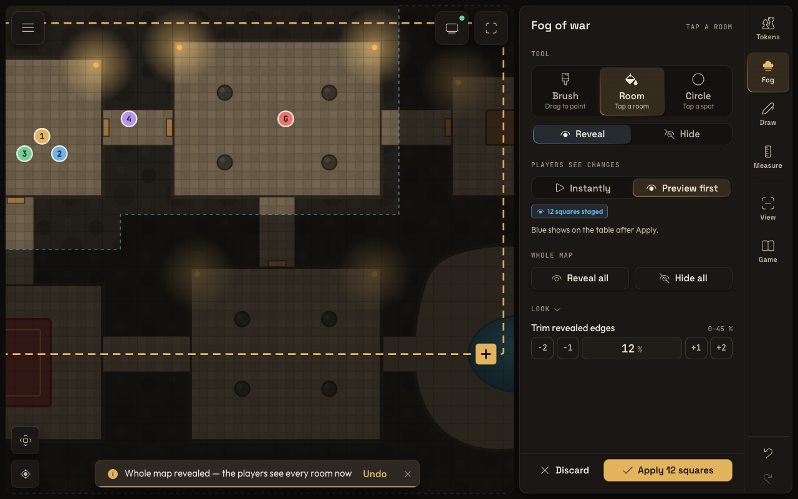
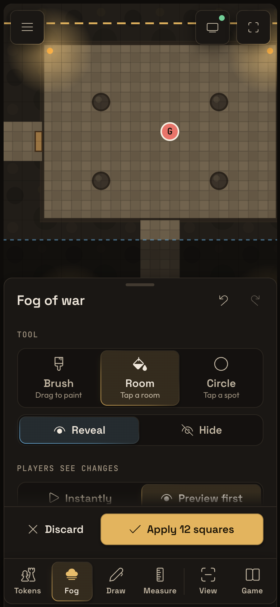
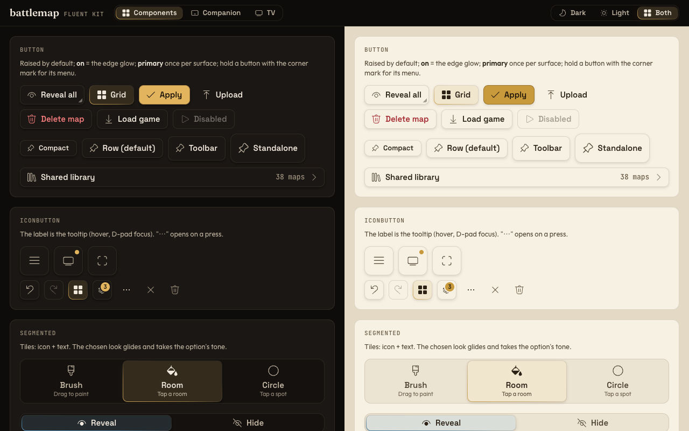
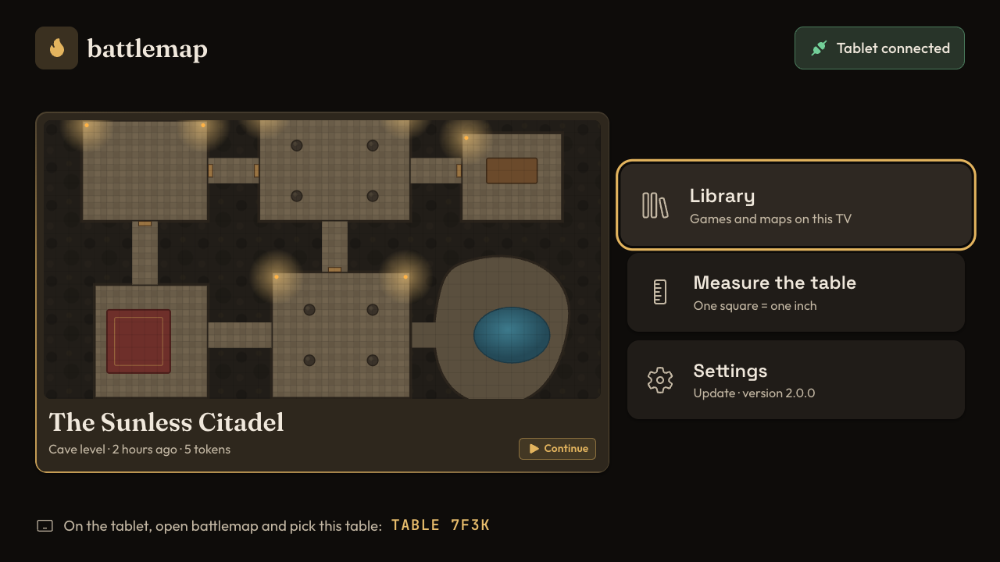

# battlemap v2 — design

battlemap's application of the fleet's fluent language. The model is the MitWare tafel demo
(`~/code/MitWare/docs/mockups/mitware-demo`, its `docs/vision.md` guidelines), the motion rules
are the stack's fluent expansion (`~/stack/claude/ui-fluent-expansion.md`), the performance
rules are `~/stack/claude/ui-performance.md`. This file says what those mean for a D&D table:
the tokens, the layout per device, how the DM's tools are grouped, and which component to
reach for. The kit itself is `app/src/lib/ui/`; its gallery is `app/kit.html` (`Kit.svelte`).



| | |
|---|---|
|  |   |

## Principles

1. **The map is the hero.** Chrome floats at the map's edges in squares, the tools sit in one
   docked surface; nothing covers the middle of the table. The map is a *wild* ground (tafel
   guideline 28): it keeps a hairline so it never melts into the gap.
2. **A dim room.** Dark is the default — a tablet must not light up the DM's face. Warm graphite
   surfaces, one warm accent (candle gold), no pure white.
3. **One gap, three radii, four control sizes.** Every distance is THE GAP (9 px) or a multiple;
   every corner is 12 / 9 / 4.5; every control is one of four sizes. No hand-picked numbers.
4. **Things that belong together sit together.** Tools are grouped by what a finger on the map
   does (modes) versus what you look at or set up (panels); inside a tab, sections group
   controls by question ("which tool?", "who sees it?", "the whole map").
5. **Calm surfaces, accent as light.** A chosen thing gets THE EDGE GLOW (a gradient burning
   from one corner into the hairline) and a faint wash — never a colour bar, never a fill. The
   one exception is the primary button: one gold fill per surface, for the commit.
6. **Same element, expanded.** Menus, the numpad and folds grow out of the control that opened
   them, on the fluent clock (bloom open, quicker close). Settings apply at once.
7. **Big, one-handed, forgiving.** Touch targets 44 px minimum, thumb-side placement, a long
   press is the second action (never a right-click), every bulk action can be undone from its
   notice.
8. **The TV is ten feet away.** Its screens scale with the screen width, ring the focus in thick
   gold, and show no chrome while all is well.

## Tokens

All in `app/src/lib/ui/tokens.css`, rem on a 16 px root (the TV scales the root). Components
read only these; a value that is not here is a question, not a choice.

| Group | Tokens | Values (dark) |
|---|---|---|
| Ground and the ladder | `--bg` `--m0` `--m1` `--m2` `--m3` `--m4` | `#0e0c0a` ground · `#1a1714` base · `#201c18` cards · `#28231e` hover · `#2e2822` open plane · `#3a332b` selected row |
| Lines | `--hair` `--hair-strong` `--wash` | warm 11 % / 20 % hairlines; 5 % wash for a pressed row |
| Ink | `--t` `--t2` `--t3` | 14.7 : 1 · 9.1 : 1 · 5.9 : 1 on `--m0` (all ≥ 4.5 : 1 on `--m3` too) |
| Accent | `--accent` `--accent-text` `--accent-ink` `--accent-hover` | candle gold `#e3b45e`; ink on gold `#1a1306` (9.6 : 1) |
| Tones | `--reveal` `--hide` `--ok` `--warn` `--err` `--info` | fog preview blue / rose (the old app's), green, orange, red; info = gold |
| Token markers | `--mark-1` … `--mark-8`, `--mark-ink` | eight hues that stay apart on any map |
| Elevation | `--elev-rest` `--elev-float` `--elev-open` `--scrim` | rest · chrome over the map · open planes, dialogs |
| Type faces → roles | `--font-headline` (Fraunces) · `--font-title` / `--font-button` (Space Grotesk) · `--font-body` (Outfit) · `--font-value` / `--font-meta` (JetBrains Mono) | components use roles, never faces |
| Type ramp | `--fs-meta` 11 · `--fs-small` 13 · `--fs-body` 15 · `--fs-field` 16 · `--fs-value` 18 · `--fs-title` 19 · `--fs-headline` 26 · `--fs-display` 40 | inputs are 16 so iOS does not zoom |
| Spacing | `--g` 9 · `--g2` 18 | half = `calc(var(--g) / 2)` |
| Radii | `--r` 12 surfaces · `--r-ctl` 9 controls · `--r-sm` 4.5 marks | pills and circles are shapes, not radii |
| Control sizes | `--sq-standalone` 56 · `--sq-toolbar` 48 · `--sq-row` 44 · `--sq-compact` 40 (+ `--icon-*`) | touch first; `(pointer: fine)` tightens to 54 / 45 / 36 / 30 |
| Layout | `--rail-w` 76 · `--panel-w` 360 · `--tabbar-h` 64 · `--dialog-w` 480 | |
| Motion | `--ease-open` `--ease-close` `--ease-glide` `--ease-std`, `--dur-*`, `--dur-hold` 420 | the clock's formulas are in `fluent.ts` |
| Focus | `--focus-w` `--focus-offset` `--focus-scale` | 2 px gold ring; TV: 6 px at 1080p and tiles grow 4 % |

**Light** (`data-theme="light"`) is parchment: `#f7f1e4` base on `#e4d9c4` ground, brown ink
(13.9 : 1), the gold darkened for text (`--accent-text` `#7a530a`, 6 : 1). A theme is an
attribute on `<html>` or on any wrapper, so a part of a page can differ.

**The TV** (`data-surface="tv"` on `<html>`, set by `setSurface('tv')`) sets the root to 1/64 of
the screen width (30 px at 1920, at any pixel ratio), so every rem token grows to 10-foot size;
elevation becomes a hairline (no blur on the Mali GPU), the edge glow stops animating, the
focus ring thickens.

**Type.** Fraunces (a soft serif) is the *story* face: game names, map names, screen titles,
the TV's wordmark — the one fantasy note, kept to names so it never turns into a costume.
Space Grotesk speaks for controls and titles, Outfit for reading, JetBrains Mono for every
number (tabular figures, so steppers never jitter). ~150 KB, shipped with the app, OFL.

## Layout per device

The app picks the layout from its own width, not from the device name.

| Width | Layout | Tools live in | Notes |
|---|---|---|---|
| ≥ 720 px, landscape (tablet — the main device; desktop) | map + one docked surface at the right edge: tool panel (360) + tab rail (76) | the rail (right edge = thumb reach) | tapping the chosen tab folds the panel; the rail stays, the map grows |
| < 720 px (phone portrait, Safari on iPhone) | map full height, tab bar at the bottom, a bottom sheet grows out of the tab bar | the tab bar | the sheet rests half or full; tapping the chosen tab closes it |
| TV | its own screens, D-pad | — | nothing but the map in a game |

Desktop is the tablet layout with the desk sizes (`pointer: fine`) and keys (below).

### Companion — game screen, tablet

```
┌─ ground (--bg), THE GAP between every surface ─────────────────────────────────────────┐
│ ┌─ map (wild ground: hairline, r 12) ──────────────────┐ ┌─ dock: panel + rail ─┬──────┐ │
│ │ [≡] game menu                       [tv●]  [⛶]       │ │ Fog of war           │Tokens│ │
│ │                                     status  full     │ │ TOOL                 │ Fog ◀│ │
│ │                                                      │ │ [Brush][Room][Circle]│ Draw │ │
│ │       the map, with the players' window              │ │ [ Reveal |  Hide  ]  │Measur│ │
│ │       (dashed gold, a grip at its corner)            │ │ PLAYERS SEE CHANGES  │──────│ │
│ │                                                      │ │ [Instantly|Preview]  │ View │ │
│ │                                                      │ │ WHOLE MAP            │ Game │ │
│ │ [⤢] fit on the tablet                                │ │ [Reveal all][Hide all│      │ │
│ │ [◎] jump to the TV's view   ( notice, over the map ) │ │ LOOK ⌄ trim stepper  │      │ │
│ │                                                      │ │ [Discard][Apply 12 ▮]│ ↶  ↷ │ │
│ └──────────────────────────────────────────────────────┘ └──────────────────────┴──────┘ │
└──────────────────────────────────────────────────────────────────────────────────────────┘
```

Map chrome: standalone squares (56) at the map's corners, `--elev-float` shadow. Top left the
game menu, top right the table status (green dot = TV connected; a warn Badge "TV not
connected" appears beside it only when it is not) and full screen. Bottom left the two camera
actions every tab needs: fit the map on the tablet, jump to what the TV shows.

### Companion — game screen, phone

```
┌──────────────────────────────┐
│ [≡]               [tv●] [⛶] │  toolbar-size squares (48)
│                              │
│        the map               │
│                              │
│ [⤢][◎]                       │
│ ╭────────── ═══ ───────────╮ │  handle: drag between half and full,
│ │ Fog of war       [↶] [↷] │ │  flick down closes
│ │ TOOL                     │ │
│ │ [Brush][Room][Circle]    │ │  the body scrolls, its edge melts
│ │ [ Reveal  |   Hide  ]    │ │
│ ├──────────────────────────┤ │
│ │ [× Discard][✓ Apply 12 ] │ │  commit stays in thumb reach
│ ├──────────────────────────┤ │  sheet and tab bar: one surface
│ │ Tok  Fog  Draw Meas│View Game│
│ ╰──────────────────────────╯ │
└──────────────────────────────┘
```

Undo / redo sit in the sheet's header while it is open and float above the tab bar when it is
closed. Notices rise above the tab bar (`--notice-bottom`).

### Library (companion)

```
┌───────────────────────────────────────────────────────────────────────────────┐
│ [≡]  [🔍 Search maps and games            ]  [Games | Maps | Shared]  [⤒ Upload]│  toolbar: controls, no title
├───────────────────────────────────────────────────────────────────────────────┤
│ ┌──────────────────────────────┐ ┌───────────┐ ┌───────────┐ ┌───────────┐     │
│ │   picture (16:9)             │ │ picture   │ │ picture   │ │ picture   │     │
│ │ The Sunless Citadel          │ │ Tower of… │ │ Salt Marsh│ │ Goblin w… │     │
│ │ Cave level · 2 h ago [▶ Cont]│ │ 30×30·WebP│ │ …         │ │ …         │     │
│ └──────────────────────────────┘ └───────────┘ └───────────┘ └───────────┘     │
│  Continue = the prominent card (glow at rest), spans two columns                │
│ ┌───────────┐ ┌───────────┐ …   cards: hold → Rename / Duplicate / Delete       │
└───────────────────────────────────────────────────────────────────────────────┘
```

The search field is the omnibar (fluent rule 11): the square widens into the field. The shared
library opens as a side Sheet on the tablet, a modal bottom Sheet on the phone, with the link
field (Field + paste IconButton) at its top and "Store as" (Segmented: WebP · best / JPEG / PNG
/ As is) at its foot.

### Upload / import dialog

```
┌─ Dialog md ─────────────────────────────────────────────┐
│ [▦] Squares on this picture                         [×] │
│     cave_40x30.webp · 1280 × 960 px                     │
│ ┌─────────────────────────────────────────────────────┐ │
│ │ picture with battlemap's grid drawn over it         │ │
│ │ [✓ Found a drawn grid: 40 × 30 squares of 32 px]   │ │  ok Badge on the picture
│ └─────────────────────────────────────────────────────┘ │
│ SQUARES                                                 │
│ Across        4–200     Down          4–200             │
│ [−1][   40   ][+1]      [−1][   30   ][+1]              │  NumberSteppers, numpad on tap
│ The picture has its own grid lines            (●  )     │  ToggleSwitch row
│ Fits the table · or "turned" · or "the TV pans"         │
│ STORE AS                                                │
│ [ WebP best | JPEG | PNG | As is ]                      │
├─────────────────────────────────────────────────────────┤
│                 [▦ Fit on the picture] [▶ Upload and play]│  primary last
└─────────────────────────────────────────────────────────┘
   while uploading: the footer becomes a ProgressBar "Uploading … 12.4 of 38 MB"
```

No grid found → the Badge says so in warn and the flat action becomes "Measure on the
picture" (the grid editor's Known length tool). On a phone the dialog rises from the bottom
edge, actions full width.

### Table calibration

Companion side (a Dialog `lg` on the tablet, full sheet on the phone) and the TV's pattern:

```
companion                                           TV (calibration screen)
┌─ Measure the TV ──────────────────────── [×] ┐    ┌──────────────────────────────────────────┐
│ ┌─ TV picture ─┐  The bar starts at          │    │░red strip (cut off)░░░░░░░░░░░░░░░░░░░░░░│
│ │◉ ·        · │  [Bottom left ▾] (tap a dot) │    │░┌─ blue line ─────────────────────────┐░│
│ │ ·    ·    · │                              │    │░│  1-inch grid       ┌ Measure ──────┐│░│
│ │ ·        ·  │                              │    │░│                    │ the gold bar  ││░│
│ └─────────────┘                              │    │░│                    │ 34 × 19 sq     ││░│
│ The gold bar measures                        │    │░│ ◉━━━━━━━━━━ 10 in   └───────────────┘│░│
│ [−10][−5][−2][−1][ 25.4 cm ][+1][+2][+5][+10]│    │░└─────────────────────────────────────┘░│
│ [ cm | in ]                                  │    └──────────────────────────────────────────┘
│ Edges the TV cuts off       [−1][ 2 % ][+1]  │
│ Pattern on the TV                     (●  )  │
│ Result: 34 × 19 squares, 34.5 in wide        │
├──────────────────────────────────────────────┤
│ [↺ Back to auto (34 × 19)]          [✓ Done] │
└──────────────────────────────────────────────┘
```

Every change applies at once (the TV redraws); "Back to auto" shows an Undo notice.

### TV — home and game

```
TV home (10-foot, D-pad)                                   TV game (all well: nothing but the map)
┌──────────────────────────────────────────────────────┐   ┌──────────────────────────────────────┐
│ [🔥] battlemap                   [🔌 Tablet connected] │   │[←]                  [⚠ Tablet not    │
│                                                        │   │ shown 5 s after a   connected]       │
│ ┌──────────────────────────────┐  ┌─ Library ────────┐ │   │ remote key          only on a problem│
│ │  game picture                │  │ Games and maps   │ │   │                                      │
│ │                              │  ├─ Measure table ──┤ │   │           the map, one square        │
│ │ The Sunless Citadel  [▶ Cont]│  │ 1 square = 1 in  │ │   │           = one inch                 │
│ │ Cave level · 2 h ago         │  ├─ Settings ───────┤ │   │                                      │
│ └──────────────────────────────┘  │ Update · 2.0.0   │ │   │                                      │
│                                   └──────────────────┘ │   └──────────────────────────────────────┘
│ [▭] On the tablet, open battlemap and pick: TABLE 7F3K │
└──────────────────────────────────────────────────────┘
```

TV library: back square, "Library" in the story face, Segmented Games | Maps, a 4-column
grid of Cards; the focused card grows 4 % and rings gold.

## The tool tabs — grouped for a DM mid-game

**Tabs are modes** (old app, 2026-10-10): being on a tab is what a finger on the map does;
there are no mode buttons inside a tab. The rail splits them in two groups by a hairline:

| Group | Tab | A finger on the map… | The panel holds, top to bottom |
|---|---|---|---|
| modes | **Tokens** (default) | places, moves, opens doors | name field + add · list "On this map" (dot + number, name, where; jump · eye · hold for rename / colour / delete) · "Not on the map yet" rows with Place |
| | **Fog** | paints / fills / circles fog | Tool (Brush · Room · Circle tiles) · Reveal \| Hide · size (Slider for the brush, NumberStepper radius for the circle) · Players see changes (Instantly \| Preview first, staged count) · Whole map (Reveal all · Hide all, Undo notice) · Look (folded: fog style, trim revealed edges) · footer: Discard · **Apply n squares** |
| | **Draw** | draws | ink swatches (the 8 marks) · line width · Pen \| Eraser · Clear all drawings (danger, Undo notice) |
| | **Measure** | measures | Ruler (on the table, turn) · Template disc (on/off) · folded sections per family (rings, cubes, cones — on/off in the header) · Disc · Lines and labels · Placement |
| panels | **View** | (Tokens behaviour) | Players see (1-inch table \| Whole map) · overview map with the window + arrow pad · On the TV (follows the tablet, show my view, rotation) · DM layers (master eye, rows with eye · opacity · hold for order / delete, Add a picture) |
| | **Game** | (Tokens behaviour) | Maps in this game (On the table badge; From device · Shared library) · This map's squares (stepper, Fit the grid on the picture) · The table (Measure the TV → calibration) · This tablet (full screen, theme) · Leave the game |

Rules for filling a tab:

- **The first section answers the first question** (which tool, which token); rare settings
  fold (`Section collapsible`) — never a second tab row, never a settings page mid-game.
- **This game vs this device** (fluent rule 9): the Game tab keeps game settings and device
  settings in separate sections ("This map's squares" / "This tablet").
- **Commit actions sit in the panel's footer**, primary last and full width; everything else
  applies at once.
- **Bulk actions** (Reveal all, Clear drawings, delete) act at once and offer Undo in the
  notice — no "are you sure?" dialog mid-game. Dialogs are for things that leave the game
  (delete a shared map).
- The **Combat / AoE** tab of the old app is digital-play only and stays out of the rail.

**Keys (desktop):** 1–6 the tabs, Ctrl Z / Ctrl Shift Z undo / redo, F full screen, Escape
closes the open plane or dialog. Shown as `kbd` caps in menus and tooltips, never the only way.

## Component inventory

| Component | Use it for | Not for |
|---|---|---|
| **Button** | an action with a word: Apply, Upload, Reveal all. `raised` default; `flat` for secondary actions in a row; `primary` = the one commit of a surface; `tone="danger"` for destructive; `on` latches; `menu` = its long-press second action (corner mark) | a choice between options (Segmented), navigation between tools (Tabs) |
| **IconButton** | map chrome squares, undo/redo, row tools (`quiet`), "⋯" menus. Label required (tooltip + accessible name) | anything whose icon is not obvious on touch — use a labelled Button |
| **Segmented** | one of 2–4 options that apply at once; `tile` layout with hints for tool choice, `inline` for short pairs; tones per option | more than 4 options (Menu), on/off (ToggleSwitch) |
| **ToggleSwitch** | a setting that is on or off; the row form with a description line, the bare form in a section header | an action (Button) |
| **NumberStepper** | every count and length: squares, radius, trim %, TV width, px sizes (decimals) — tap the number for the Numpad | free ranges where feel matters (Slider) |
| **Slider** | brush size, line width, opacity — previews while dragging, sends on release | exact numbers |
| **Tabs** | the tool rail / tab bar — tabs are modes | switching content inside a panel (Segmented) |
| **Panel** | a floating surface with title, scrolling body, pinned footer | a modal question (Dialog) |
| **Section** | a group of controls under an eyebrow heading; `collapsible` for rare settings; `trailing` for a header switch | boxing things in borders |
| **ListRow** | tokens, layers, maps in a game, a setting that opens something (`chevron`) | big pictures to choose from (Card) |
| **Card** | a map or game to open (library, TV library); `prominent` for Continue, `selected` for the current | dense lists (ListRow) |
| **Field** | names, links, search (machine text: helpers off); `kind="prose"` + `multiline` for notes | numbers (NumberStepper) |
| **Sheet** | bottom: the phone's tool panel, modal lists on the phone; right/left: side lists on tablet and desktop | a decision (Dialog) |
| **Dialog** | a decision or a short task that interrupts: upload squares, measure the TV, delete from the shared library | settings that could apply at once |
| **Menu** | a button's other actions (long press), "⋯" options, value lists > 4 | primary navigation |
| **Plane** | any small panel grown from a control (a colour picker, quick token settings) | full screens |
| **Notice** (`notify`, `NoticeHost`) | every short message: saved, failed, revealed · Undo. Closes by itself, replaces, a finger pauses it | errors that block work (Dialog), progress (ProgressBar) |
| **Spinner** | a short wait with no measure; inside a busy Button via `loading` | waits over ~2 s with a known size (ProgressBar) |
| **ProgressBar** | uploads, downloads, PDF rendering — label + "x of y MB" | |
| **Badge** | a state word beside a name (On the table, Hidden, 12 staged); `size="tv"` for the TV's problem badge | actions |
| **Tooltip** | naming a control on hover and keyboard / D-pad focus | explanations (put them in the UI), anything on touch |
| **Icon** | Fluent UI System Icons (MIT), 84 used, in `icons.ts` under battlemap's own words; `filled` for selected states | |

Helpers: `hold` (long press), `tooltip`, `scrollFade` (melting scroll edges), `grow` / `rise`
transitions and `openMs` / `closeMs` (`fluent.ts`), `plain` / `prose` field attributes
(`fields.ts`), D-pad navigation (`spatial.ts`), `portal` / `placePlane` (`plane.ts`).

## Motion

- **One clock** (`fluent.ts`): open `min(440, 200 + 0.6·px)` ms on easeOutBack, close
  `min(310, 140 + 0.45·px)` ms on easeOutCubic — closing is quicker, that asymmetry is the
  signature. Heights are measured, never `0fr → 1fr`.
- **Planes grow out of their control** (Menu, Numpad, Plane): the control takes the open tone,
  squares its joined corners, a concave fillet joins a wider plane — one surface.
- **A chosen look glides** (Segmented, Tabs): one surface slides to the new option on the same
  clock with a ~1 % overshoot, and morphs its tone.
- **Big surfaces do not bounce:** sheets and dialogs move on the closing curve only.
- **Hold** fills the button's face over 420 ms, then the menu opens; letting go over a row picks.
- **Only transform and opacity animate** (plus a plane's measured height while it opens). No
  rAF loops: the notice countdown is a CSS animation whose end closes the notice; the spinner
  is a CSS rotation. A static screen writes nothing (checked: 0 DOM writes idle and while
  scrolling the panel).
- **Reduced motion:** every `--dur-*` token becomes 1 ms and `still()` returns true — geometry
  still lands; spinners and the notice countdown keep running (they carry information).
- **TV:** no animated gradients, no blur, no large shadows; focus moves are instant, a focused
  tile grows by transform.

## Focus and the D-pad

- Every TV control is a real `<button>` (or link / input) — focusable, OK activates it.
- `installDpad()` (`spatial.ts`) moves the focus **geometrically**: nearest control in the
  pressed direction, same row / column preferred, a penalty for sideways distance. Text
  fields keep ← → for the caret until it reaches an end; sliders and selects keep theirs.
- An open modal dialog (top layer) or a `[data-nav-scope]` keeps the D-pad inside it.
- Back (Escape, the remote's Back) is offered to the focused element as a bubbling `bm-back`
  event first, then to the screen's `onBack`.
- Each screen marks its starting control `data-autofocus` and calls `focusFirst()` on show.
- The ring: `:focus-visible` = 2 px gold outline following the radius; on the TV 6 px at 1080p
  and `[data-focus-grow]` tiles grow 4 %. An activator whose plane is open drops its ring —
  the plane is the focus context.
- Holding OK on a button with a menu opens the menu (focus moves into it, ↑ ↓ walk, OK picks).
- The TV shows **no chrome while all is well**: the back square appears for 5 s after a remote
  key (it stays focusable); the problem badge appears only on a problem.

## Touch

- **44 px minimum** for anything a finger hits (`--sq-row`); 40 for menu rows and stepper
  chips, which sit in lists with gaps; tool tiles 64 tall. The desk (`pointer: fine`) tightens.
- Hover looks exist only under `(hover: hover)` — a tapped tablet button never keeps one; touch
  gets the pressed tone (`:active`; iOS needs a `touchstart` listener on the document).
- `touch-action: manipulation` (no double-tap zoom), no text selection or callout on controls,
  the long press is ours (the system context menu is suppressed on hold buttons).
- Two fingers on the map always move the view; the tool starts on the first one-finger move
  (old app rule, the map's job, not the kit's).
- Inputs are 16 px (iOS zoom), machine-text fields switch off autocorrect, capitals, spell check.

## Performance and accessibility

- Shared looks are CSS classes (`.bm-sf`, `.bm-glow`), not per-component paint. The edge glow
  is a static gradient; its 300 ms transition is off on the TV.
- Measurements write only when their rounded signature changed (Segmented, Tabs,
  NumberStepper, scrollFade); ResizeObservers measure inside their callback.
- Contrast: every text token ≥ 4.5 : 1 on the surfaces it sits on, both themes (values above).
- Semantics: native buttons, `role="switch" / "radio" / "tab" / "menu"` where they apply,
  `aria-live` on notices (`alert` for errors), labelled progress bars, dialogs on `<dialog>`.

## Open points

- **Kit tests** — `ui/kit-logic.test.ts` (bun, 13 cases: D-pad geometry, plane placement,
  one plane at a time, notice show times, the fluent clock). It pulls in the bun types with a
  `/// <reference types="bun" />`; if the app prefers all tests under `app/test/`, move it there.
  The components themselves are checked through the gallery (Playwright screenshots).
- **The notice slot**: the kit owns it (`notify`, `dismiss` in `ui/notice.svelte.ts`);
  `lib/notices.svelte.ts` should re-export them and add the logging.
- Not built yet, sketched above: the omnibar search (Field + Plane), the side variant of the
  shared library, the grid editor's full-screen layout, a colour picker Plane.
- Real WebKit / Android WebView check of the hold → release-to-pick path and the Plane's
  concave fillet (verified in headless Chrome only).
