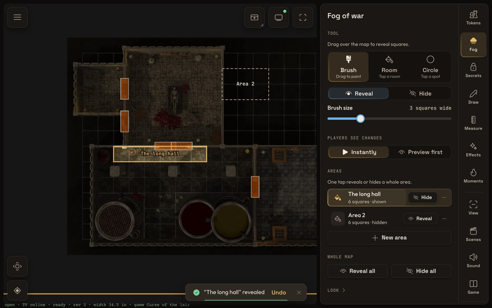
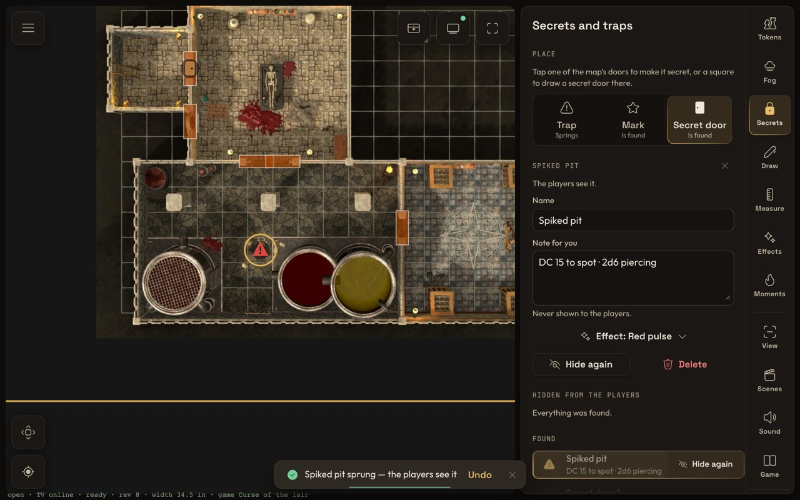

# battlemap v2 — features

Features built on top of parity, one section each: what it does at the table, how it works,
its protocol, and its limits. Built in wave 4 (W4-F) unless a section says otherwise.

## The curtain (roadmap N8)

**What.** One button on the tablet holds the TV on black — or on a calm "next scene…" plate —
until the DM lifts it. Behind it the DM switches maps, reveals fog, places tokens, effects and
weather; the players see none of it. Lifting shows the new state in one fade. Uses: setting up
the next room or map without spoilers, a break, moving the minis around.

**On the tablet.** A square in the map's top-right corner, next to the TV status, on every tab
(it is chrome, not a tab: one tap from anywhere, design.md "map chrome").

- **Tap** = lower / lift. While down the square is latched gold and a Badge beside it says
  "Curtain down" (or "Curtain down · plate"); the DM's own map stays as it is.
- **Hold** (cross-project long-press rule) unfolds its menu: *Lower / Lift the curtain* (the
  default, first), *Black*, *Next scene plate* (the current one checked; it changes at once, also
  while the curtain is down), *Plate text…* (a small dialog: one line, ≤ 120 characters; saving
  it also switches to the plate).
- A notice says what the TV does now ("Curtain down — the TV is black").

**On the TV.** The topmost screen-space layer (`app/src/lib/render/curtain-layer.ts`), above the
table mask and `fx.screen`, so it covers flashes and weather too.

- *Black*: the ground colour (`--bg`), nothing else.
- *Plate*: a small gold eyebrow "NEXT SCENE", the game's name in the story face (Fraunces), a
  gold hairline, the DM's line (Outfit, muted) — and a slow ambient: a candle glow that breathes
  and 26 embers drifting up, at 15 frames a second (`hold('curtain-ambient', 15)`), sizes from
  the TV's rem (1/64 of the width), colours read from the design tokens.
- **The promise: no change made behind the curtain shows before it lifts.** The timing is a pure
  state machine (`render/curtain-clock.ts`, tested):
  - *falling* (700 ms, sine ease): the scene keeps drawing the state from before the curtain was
    asked down — even if the same update switched the map; newer states wait (`heldBack`).
  - *down*: the world, the table mask and `fx.screen` are switched off (no fill cost under the
    plate); the newest state is drawn behind it, so the new map loads unseen.
  - *lift*: a lift asked during the fall waits for the fall to finish, then the curtain stays
    down at least 300 ms; it rises (1 s) once the map behind is on screen (`map-shown` /
    `map-failed`), at the latest after 4 s.
  - *another game or the first state*: no fade — the curtain snaps to what the game says, so a
    TV that reloads mid-setup comes back behind the curtain.
- Render on demand holds: a lease only while it fades or waits to rise; black that just stands
  there draws no frames; the plate draws 15 a second.
- **The remote's Back** with the curtain down lifts it first (so a TV whose tablet died is never
  stuck behind it); the next Back closes the game as before. The curtain is saved with the game,
  so a game reopened from the TV is still behind it until it is lifted. While it is down the
  TV's busy card stays hidden too — nothing names the map being prepared.

**Protocol.** `Game.curtain {down, plate, text}` (saved; optional on the wire, games stored
before it read as up / black / no text). One command, `curtain.set {down, plate?, text?}` —
explicit values, `plate` and `text` kept when missing, no undo step, not map-scoped
(`docs/protocol.md` "commands").

**Limits.**

- The DM's view shows no curtain (the badge says so); the tablet sees everything as always.
- The plate text is upright for one side of the table (the TV lies flat).

## Scene presets (roadmap S2)

**What.** The DM saves a *scene* — which map of the game, how the TV frames it (one-inch window
and its position, whole map or free camera, rotation), the weather and other global effects, the
placed map loops (torches, fires, areas — every lasting effect not bound to a token), the map
lights switch and the fog look (style, trim, fade) — and later puts it back with one tap, by
default under the curtain (lower, switch, lift). Fog, doors, tokens and drawings are never part
of a scene: they are the story so far and stay as they are.

**Where: a Scenes tab, in the panels group right after View.** Considered: a section of the Game
tab. Rejected because Game holds the setup (maps, squares, calibration, leaving) and is visited
rarely, while scenes are the DM's pacing tool mid-game — they need to be one tap from the rail.
A scene is "what the players see", so it sits next to View. It is a panel, not a mode: a finger on
the map keeps the Tokens behaviour, so the DM can tidy tokens while the list is open.

**The tab.**

- A row per scene: a thumbnail of what the TV will show (the map's picture — its table copy
  when there is one — cropped by CSS to the scene's window, no extra file), the name, and a line
  ("Vampire lair · rain · 2 map loops · lights · cloud fog"). The scene that matches the table
  right now is selected and badged "On the table" (`sceneShown`, a deep compare).
- **Tap** = put it on the table. One switch at a time (the rows wait, "Switching…").
- **⋯** = Update from now (same name and place, takes what the table shows), Rename…, Move up /
  down, Delete (danger; the notice's Undo saves it back at its index — no "are you sure?").
- Footer: **Save the table as a scene** (the one primary button). The name is "<map> · n" so
  saving never waits for typing; rename later. At most 24 scenes per game.
- **Switch under the curtain** (this tablet only, remembered; on by default — the point of a
  scene switch is that the players don't watch it happen): curtain up → lower, wait 900 ms
  (the TV's fall), `scene.apply`, wait 600 ms, lift (the TV itself waits for the new map before
  it fades in). A curtain that is already down stays down — the DM is setting up and lifts it.
  Off: the scene applies at once.

**Protocol.** `Game.scenes: Scene[]` (saved, optional on the wire, ≤ 24). A `Scene` is
`{id, name, mapId, view, effects, mapLights, fog: {style, edgeInset, fade}}`, made by the
companion from its predicted state with the shared `captureScene` (so the reducer stays a plain
store and the TV keeps exactly what the DM saw). Commands (no undo steps, not map-scoped):

| Command | Does |
|---|---|
| `scene.save {scene, index?}` | adds (at `index` or the end) or replaces by id ("update from now"); refused for a map not in the game or past 24 |
| `scene.remove {id}` | deletes (an unknown id: nothing) |
| `scene.rename {id, name}` | renames |
| `scene.order {ids}` | the new order; refused unless every scene is named once |
| `scene.apply {id}` | the scene's map on the table with its view; its effects replace the map's except token-bound ones (`sceneEffects`); `mapLights`, `fogStyle`, `fogEdgeInset`, `fogFade` set; live tools cleared when the map changed; refused when the scene or its map is gone |

**Limits.**

- Ambient sound (S1) and time of day / dim (S3) are not in a scene yet — they don't exist; when
  they land they join `Scene` as optional fields.
- A scene whose map left the game stays in the list, dimmed ("Its map left the game"), so the DM
  decides; it can't be applied.
- Applying a scene makes no undo step (like a map switch); the effects it replaced come back by
  applying the scene that had them.
- The thumbnail shows the picture without fog, tokens or effects — it is "where", not "how it
  looks now".
- Two companions saving scenes at once is fine (ids are made by the sender); a reorder sent while
  the other one added a scene is refused ("The scenes changed meanwhile") and the DM taps again.

## Fog-honest thumbnails (roadmap S24)

**What.** The TV's own screens no longer spoil the map: the home's Continue card and the
library's game cards show each game **as the players last saw it** — the picture with its fog,
cropped to what was revealed plus a square around it — or a neutral card while nothing is
revealed. Shared maps in the TV library show no picture at all (a whole map is a spoiler). The
tablet keeps the server's full thumbnails: the DM may see everything.

**On the TV.** Made on the TV after the game saves, off the critical path: 3 s after an
autosave and at most every 30 s per game while playing, 300 ms after a close or any other
flush. Never while the curtain is down (the players saw the curtain, not what the DM prepared
behind it) — the last thumbnail stays. The picture (its table copy when there is one) is decoded
small, cropped, fogged with a one-pixel-per-square mask drawn smoothed, and stored per game in
the TV's settings store as a 480 × 270 WebP data URL with a signature of map, picture and
revealed squares, so an unchanged fog is never drawn twice. Each game waits on its own timer: a
close of one game and the next game's autosave both get theirs. `tv/fog-thumbs.ts` (planning,
pure), `tv/fog-thumbs-draw.ts` (canvas), `TvGames.onSaved`.

**Protocol.** None: thumbnails stay on the TV.

**Limits.**

- A game not saved on this TV since this build shows a neutral card until its next save.
- The thumbnail shows map and fog only (no tokens, drawings, doors); secret doors drawn into the
  picture itself are in it as they are on the table.

## Reveal animation (roadmap S4)

**What.** When the DM reveals, the TV's fog no longer just fades: it rolls back in soft wisps of
smoke, starting next to what the players already see and spreading outward, so a door opening
onto a hall reads as the darkness drawing back. Hiding stays instant.

**On the TV.** Each newly revealed square keeps full fog for a moment and dissolves over 900 ms
(ease-out). Squares start staggered by their Chebyshev distance from the fog revealed before
(nothing revealed yet: from the centre of the change), 40 ms per square, compressed so the
whole reveal ends within 1.6 s. The fog shader samples the "fog still to go" between square
centres (a smooth front, no blocky squares) and cuts it with three octaves of slowly drifting
value noise in map squares; the dissolving band gets a faint warm-grey smoke tint. The shader
pays for this only while a reveal runs (a uniform-gated branch, fragments of squares not
animating skip it); the render lease is held only while squares animate, idle is 0 frames.
Wisps need the game's effects on and the screen's effects quality at full; otherwise the TV
shows the plain 500 ms fade. The DM's view keeps the plain fade — cheaper on tablets, and its
fog is 70 % anyway. `render/reveal-anim.ts` (timing), `render/fog-layer.ts` (shader),
`FogLayer.setRevealQuality` set by `TableScene`.

**Protocol.** None: the switch is the existing game setting `fogFade` (default on), relabelled
"Reveal animation" in the game settings ("Revealed fog rolls back in soft wisps instead of
vanishing at once."). Off = a hard cut, as before.

**Limits.**

- The stagger ignores walls: the front spreads by square distance, not through doorways.
- A square hidden and revealed again mid-animation starts over.
- No per-screen quality switch exists yet; the effects runtime's quality (default full) is read.

## Prepared reveal areas (roadmap S7)

**What.** In prep the DM outlines named areas — "the crypt", "behind the secret door" — and at
the table one tap reveals (or hides) a whole area, with the reveal animation. An area is just a
name and a set of squares; whether it is shown is read from the fog (all, some or none of its
squares), never stored, so it can't disagree with what the players see.

**On the tablet.** The Fog tab's "Areas" section lists them: name (or "Area n"), size and what
the players see ("12 squares · 5 shown"), and one button — **Reveal** while hidden or partly
shown, **Hide** once fully shown — with Undo in its notice (under "Preview first" the squares
wait in the preview like any fog change). A tap on the row selects the area (gold on the map) and
centres the view on it; "⋯" offers Edit squares, Rename… and Delete (Undo in the notice).
**New area** (or Edit squares) turns the Fog tab into the area's editor: the finger edits the
area instead of the fog — **Paint** (tap or drag over squares), **Room** (a tap fills the room,
stopped by walls and closed doors; maps with walls only) or **Outline** (taps set corners snapped
to square corners, a tap on the first corner or Close outline takes the squares whose centres are
inside) — each in **Add** or **Take out**; the footer is Cancel · **Save area**. Nothing is sent
before Save; leaving the tab or another map coming on the table drops the draft. The tab's
overlay draws every area's outline (a dashed hairline) with its name, the selected one gold and
the draft filled gold — SVG paths in squares under one camera transform, rebuilt only when the
areas change. Corners snap so the outline runs along the grid lines the DM sees: which squares
end up inside is predictable, and a shaky finger can't miss a corner by a hair.

**On the TV.** Nothing of the areas — only the fog they change.

**Protocol.** `area.save {area, index?}`, `area.remove {id}` (no undo steps: an area is prep,
not play — the notice's Undo saves the old one back, as scenes do), `area.reveal {id, value,
gesture}` = `fog.apply` with the area's squares (one fog undo step). `MapPlay.areas` (optional on
the wire, ≤ 64); `playersState` drops them.

**Limits.**

- An area is squares, not walls: revealing it ignores doors and walls (that is the point).
- Areas belong to one map; an area can't be moved to another map.
- Two DMs editing the same area at once: the last Save wins.

## Secret doors and traps (roadmap S9)

**What.** Traps, hidden marks (a lever, loot, a clue) and secret doors the players don't see
until the DM marks them found — then they appear on the TV with a small effect. A trap is a DM
mark on a square with an optional note ("DC 15 to spot, 2d6 piercing") that the DM **springs**:
its effect plays and its warning glyph appears for the players.

**Where: a Secrets tab** (between Fog and Draw), not a Fog section: placing secrets is its own
finger action (tabs are modes — in this tab a tap places or selects a secret and never toggles a
door), and mid-game the list with its Found / Spring buttons is one tap from the rail. The Fog
tab stays about fog.

**On the tablet.** "Place": Trap · Mark · Secret door — a tap on an empty square places the
chosen kind there (Undo in the notice); with Secret door chosen, a tap on one of the map's own
doors makes that door secret. A tap on a secret selects it: its editor holds the name, the note
(never shown to the players), the effect it plays (a short list per kind — dust, a gold or red
pulse, a glyph, an explosion, poison — or none), a drawn door's direction (Across | Down), its
one-tap button and Delete (Undo). The lists "Hidden from the players" (one-tap **Found** /
**Spring**) and "Found" (Hide again) — every action with Undo in its notice. On the DM's map every
secret shows as its kind's glyph — a red triangle, a gold diamond, a door slab — hollow while
hidden, filled once found; the selected one gets a gold ring.

**On the TV.** Nothing of an unfound secret: a secret door that is one of the map's own doors
loses its drawn leaf (AI maps). Found: a door appears as a closed wooden leaf (on its square, or
along the map's doorway when the map doesn't draw doors anyway), a mark as a small gold sigil, a
sprung trap as a red warning glyph — above the fog (the players know about it now), and the
secret's effect plays once on the square. Finding changes no fog. `render/secrets-layer.ts`,
built only when the secrets change.

**Protocol.** `secret.save {secret, index?}` and `secret.remove {id}` (no undo steps — prep; the
notice's Undo saves back), `secret.found {id, found, shot?}` (the shot plays on every screen like
`fx.trigger`'s; Undo is `found: false`). `MapPlay.secrets` (optional on the wire, ≤ 128);
`playersState` keeps only found secrets, without notes.

**Limits.**

- A secret door painted into the map's picture is in the picture: hiding it is the map maker's
  job (published maps draw secret doors as walls).
- A found secret door is drawn closed; it opens as a map door only when it is one.
- The effects are the catalogue's; a secret with an effect that left the catalogue plays none.

## Table moments (roadmap S6, S8, S10, S11)

Built in wave 5 (W5-2). Four short things a DM does to the table mid-game.

**What.**

- **Spotlight** (S8): a tap on a mini lights a soft warm ring under it and dims the rest of the
  table a little (None / A little / More); it follows the mini when it moves and goes out while
  the mini is hidden. A tap on an empty square lights the square; a tap on what is lit puts it
  out (also Put out in the panel). Shows whose turn it is or where the moonlight falls, with no
  initiative list. The DM's own map dims at 45 % of that so it stays readable.
- **Timer on the TV** (S11): a countdown ring at the middle of both long edges of the table, each
  turned upright for its side, with the time in big digits. 30 s / 1 min / 5 min start with one
  tap, a custom length in seconds with its button; Pause / Resume / Again, Reset, Off the TV. The
  last 10 seconds pulse gently; at the end the rings flare gold (Glow), the table flashes warm
  white once (Flash), or it just reads 0:00 (None).
- **Handouts** (S10): pictures (uploaded with progress, or taken from this map's DM layers) and
  short letters (≤ 2000 characters) kept per game (≤ 32). A tap on a row shows it **at the
  table's edge** — a card against the chosen side, the map stays — the default, because a
  full-screen card covers the minis' area (roadmap ⚠). The row's full-screen button shows it as
  a **pause card** over a dark table. "Reads upright for the players at the" Bottom / Top / Left /
  Right turns it (this tablet remembers; a showing handout turns at once). Back to the map: the
  panel's button, the chip on the map, a second tap on the row, or the remote's Back on the TV.
  Letters are parchment with the name in the story face; the TV sizes the text by its length.
- **DM notes** (S6): pins with a short line ("Trap here", "DC 15 lock"), seen only on the tablet,
  saved per map. A **long press on the map** opens the note dialog — in every tab but Draw and
  Fog, where a still finger is the start of a stroke. In the Moments tab a pin is tapped to edit
  and dragged to move (one undo step per drag); the list jumps the view to a pin; delete has Undo.

**Where: one Moments tab, a mode right after Measure.** The spotlight needs its own finger on the
map (Tokens' taps place and select tokens), so it is a mode; being on the tab is "the finger
lights". The four live in one tab rather than four: each is a few controls, and four tabs would
crowd the rail and the phone's tab bar; View and Game hold setup, not moments. The panel opens on
the spotlight and the timer (the two that must be one tap away), then handouts, then notes. What
must reach the DM from any tab sits outside the panel: the long press for notes, and two chips at
the map's top-right beside the curtain while something runs — the timer's time (tap = pause /
resume, hold = Reset, Off the TV) and "Handout" (tap = off the TV).

**How.** `render/moments-layer.ts` draws all three on the table view (the maths in
`moments-logic.ts`, tested): the spotlight is one sprite (ring, warm pool and the dim's soft edge
from a small canvas texture, redrawn only when the dim changes) plus one graphics of four rects
for the dim around it, under `fx.air`; it glides 260 ms to a new place and fades in / out on a
lease, so a still spotlight costs no frames. Notes are a pin and a pill of bitmap text at screen
size, upright whatever the camera's turn, built only on the DM's view. The countdown sits in
screen space above `fx.screen`, under the curtain: while it runs the layer draws one frame per
printed second (a timeout at the next whole second, no lease), a 30 fps lease only for the last
ten seconds' pulse and the 1.6 s end effect. The TV's handout is a DOM card (`tv/TvHandout.svelte`,
placement in `tv/handout.ts`) over the canvas, hidden while the curtain is down; its picture
comes from the TV's file cache.

**The clock.** A timer is plain data stamped with the **server's clock**: `startedAt` (null while
stopped) and `remainingMs` then. The tablet makes each new value with `startTimer` /
`pauseTimer` / `resetTimer` at `serverNow()`; every screen works out what is left with
`timerLeft`, so a TV that reloads keeps counting, and a TV that reloads long after the end shows a
quiet 0:00 instead of replaying the end effect. The TV's table view now ages one-shots by the
server's clock too (it was the TV's own, rv#16).

**Protocol** (protocol.md; all optional on the wire, read as none for games stored before them).
`MapPlay.notes` (`{id, x, y, text}` in squares, ≤ 200) and `MapPlay.spotlight` (`{target: square
{col, row} | token {tokenId}, dim}` or null); `Game.timer` (`{durationMs, remainingMs, startedAt,
endEffect}` or null), `Game.handouts` (≤ 32 `{id, name, kind: picture | letter, file, text}`),
`Game.handoutShown` (`{id, place: edge | full, side}` or null).

| Command | Does |
|---|---|
| `spotlight.set {spotlight}` | on a square (clamped onto the map) or a token of the map, or null; map-scoped, no undo |
| `timer.set {timer}` | the whole value or null; game-wide, no undo |
| `handout.save {handout, index?}` | adds or replaces by id (a picture needs its file); refused past 32 |
| `handout.remove {id}` | deletes; takes it off the TV if it shows |
| `handout.show {shown}` | `{id, place, side}` or null; refused for a handout that is gone |
| `note.set {note, gesture?}` | adds or replaces by id (clamped onto the map); one undo step per gesture; refused past 200 |
| `note.remove {id}` | deletes, one undo step |

DM notes never reach the players: `withoutDmNotes` drops them and their undo steps, and the
players' view (`playersView`, S12) is built through it.

**Limits.**

- Notes stay with the map in this game; they don't travel with a shared-library map yet (S6's
  "travelling with library maps").
- An edge handout sits over the map's edge squares when the table window leaves no margin there.
- The timer is one per game; two at once (a round and a ritual) would need a list.
- The spotlight is one per map; a second tap elsewhere moves it (by design: no order, no list).
- Handouts are not sent to player phones yet (S12 shows the one on the TV).

## Checks

- `bun test` in `shared/` (`test/scenes.test.ts`: curtain down / up, kept fields, changes behind
  it, save / update / rename / order / delete / Undo, apply, refusals, the wire, old games) and in
  `app/` (`render/curtain.test.ts`: the clock's promise; `companion/tabs/scenes/scenes-logic.test.ts`:
  names, summaries, frames, thumbnails, moves, the menu, the switch sequence).
- e2e `e2e/feature-curtain-scenes.e2e.ts`: lower → switch map → reveal → plate → lift (TV
  brightness measured on screenshots); two scenes saved and switched under the curtain and
  straight; delete with Undo. Shots: `docs/qa/w4f-*.jpg`.
- Reveal animation: `bun test src/lib/render/reveal-anim.test.ts` in `app/` (stagger order, the
  1.6 s cap, hide instant, re-reveal, idle after); e2e `e2e/feature-reveal-anim.e2e.ts` (TV shots
  at ~150 / 400 / 700 / 1000 ms, the far side darker than the near one mid-way, all map after).
  Shot: `docs/qa/w5-1-reveal.jpg`.
- Fog-honest thumbnails: `bun test src/lib/tv/fog-thumbs.test.ts` in `app/` (signature, revealed
  box, crop, plan: keep / neutral / draw, curtain keeps, scheduling per game, throttle).
- Reveal areas: `bun test src/lib/companion/tabs/fog/areas` in `app/` (state from the fog, outline
  paths, polygon → squares, centres; the flow: paint / room / outline, save, reveal / hide with
  Undo, delete with Undo at its place, a map switch drops the draft); `shared/test/secrets.test.ts`
  (area.save / remove / reveal). e2e `e2e/feature-fog-secrets.e2e.ts` "reveal areas". Shot:
  `docs/qa/w5-1-areas.jpg`.
- Secrets: `bun test src/lib/companion/tabs/secrets src/lib/render/secrets-logic.test.ts` in `app/`
  (placing, map doors, labels, shots, found / spring with Undo, delete with Undo; what each view
  draws); `shared/test/secrets.test.ts` (found, sprung, the players' state never holds an unfound
  secret or a note). e2e "secrets": the TV unchanged while hidden, changed once found / sprung.
  Shots: `docs/qa/w5-1-secrets.jpg`, `docs/qa/w5-1-secrets-tv.jpg`.
- Table moments: `bun test` in `shared/` (`test/moments.test.ts`: reducer cases, refusals, notes
  undo per gesture, `withoutDmNotes`, timer maths across a reload) and in `app/`
  (`render/moments.test.ts`: spotlight centre, the countdown face on the server clock, end effect
  only right after the end, ring places, note hits; `companion/tabs/moments/moments.test.ts`: the
  tap rule, the panel's words, the timer buttons, the once-a-second readout, the tool on a fake
  screen, the long press; `companion/input/hold.test.ts`; `tv/handout.test.ts`; `tv/screen.test.ts`
  Back). e2e `e2e/feature-moments.e2e.ts`: spotlight dims the TV (measured), timer rings in the
  margin, paused from the chip and kept across a TV reload, a letter at the edge, turned, full
  screen, off with the TV's Back, a note from a long press. Shots: `docs/qa/w5-2-*.jpg`.
