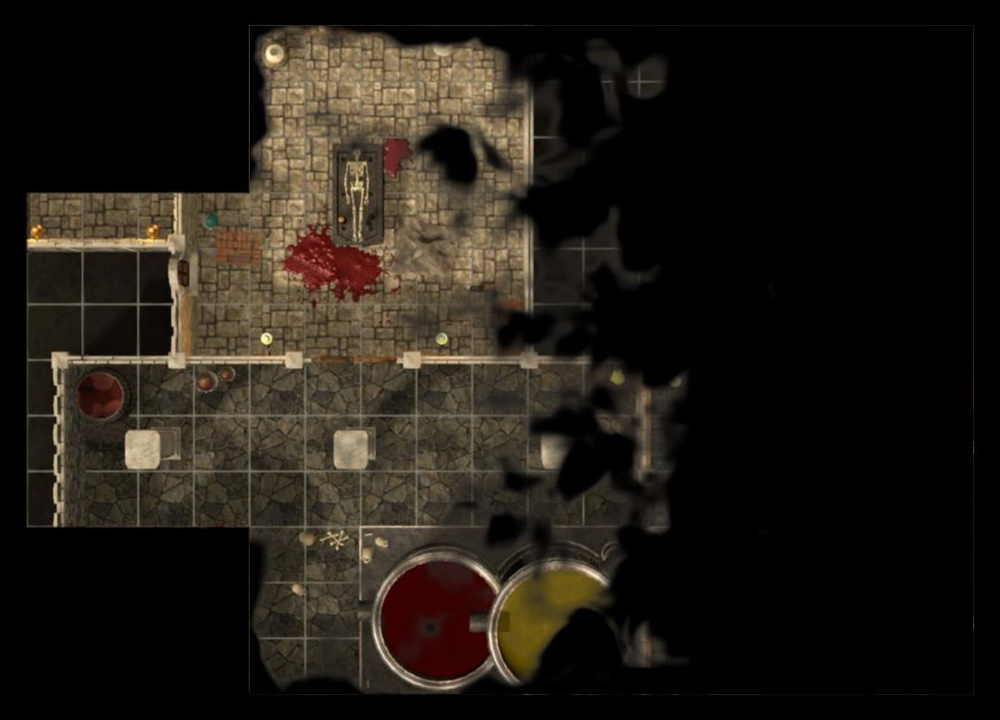

# battlemap v2 — features

Features built on top of parity, one section each: what it does at the table, how it works,
its protocol, and its limits. Built in wave 4 (W4-F) unless a section says otherwise.

## The curtain (roadmap N8)

**What.** One button on the tablet holds the TV on black — or on a calm "next scene…" plate —
until the DM lifts it. Behind it the DM switches maps, reveals fog, places tokens, effects and
weather; the players see none of it. Lifting shows the new state in one fade. Uses: setting up
the next room or map without spoilers, a break, moving the minis around.

**On the tablet.** A square in the map's top-right corner, next to the TV status, on every tab
(it is chrome, not a tab: one tap from anywhere, design.md "map chrome").

- **Tap** = lower / lift. While down the square is latched gold and a Badge beside it says
  "Curtain down" (or "Curtain down · plate"); the DM's own map stays as it is.
- **Hold** (cross-project long-press rule) unfolds its menu: *Lower / Lift the curtain* (the
  default, first), *Black*, *Next scene plate* (the current one checked; it changes at once, also
  while the curtain is down), *Plate text…* (a small dialog: one line, ≤ 120 characters; saving
  it also switches to the plate).
- A notice says what the TV does now ("Curtain down — the TV is black").

**On the TV.** The topmost screen-space layer (`app/src/lib/render/curtain-layer.ts`), above the
table mask and `fx.screen`, so it covers flashes and weather too.

- *Black*: the ground colour (`--bg`), nothing else.
- *Plate*: a small gold eyebrow "NEXT SCENE", the game's name in the story face (Fraunces), a
  gold hairline, the DM's line (Outfit, muted) — and a slow ambient: a candle glow that breathes
  and 26 embers drifting up, at 15 frames a second (`hold('curtain-ambient', 15)`), sizes from
  the TV's rem (1/64 of the width), colours read from the design tokens.
- **The promise: no change made behind the curtain shows before it lifts.** The timing is a pure
  state machine (`render/curtain-clock.ts`, tested):
  - *falling* (700 ms, sine ease): the scene keeps drawing the state from before the curtain was
    asked down — even if the same update switched the map; newer states wait (`heldBack`).
  - *down*: the world, the table mask and `fx.screen` are switched off (no fill cost under the
    plate); the newest state is drawn behind it, so the new map loads unseen.
  - *lift*: a lift asked during the fall waits for the fall to finish, then the curtain stays
    down at least 300 ms; it rises (1 s) once the map behind is on screen (`map-shown` /
    `map-failed`), at the latest after 4 s.
  - *another game or the first state*: no fade — the curtain snaps to what the game says, so a
    TV that reloads mid-setup comes back behind the curtain.
- Render on demand holds: a lease only while it fades or waits to rise; black that just stands
  there draws no frames; the plate draws 15 a second.
- **The remote's Back** with the curtain down lifts it first (so a TV whose tablet died is never
  stuck behind it); the next Back closes the game as before. The curtain is saved with the game,
  so a game reopened from the TV is still behind it until it is lifted. While it is down the
  TV's busy card stays hidden too — nothing names the map being prepared.

**Protocol.** `Game.curtain {down, plate, text}` (saved; optional on the wire, games stored
before it read as up / black / no text). One command, `curtain.set {down, plate?, text?}` —
explicit values, `plate` and `text` kept when missing, no undo step, not map-scoped
(`docs/protocol.md` "commands").

**Limits.**

- The DM's view shows no curtain (the badge says so); the tablet sees everything as always.
- The plate text is upright for one side of the table (the TV lies flat).

## Scene presets (roadmap S2)

**What.** The DM saves a *scene* — which map of the game, how the TV frames it (one-inch window
and its position, whole map or free camera, rotation), the weather and other global effects, the
placed map loops (torches, fires, areas — every lasting effect not bound to a token), the map
lights switch and the fog look (style, trim, fade) — and later puts it back with one tap, by
default under the curtain (lower, switch, lift). Fog, doors, tokens and drawings are never part
of a scene: they are the story so far and stay as they are.

**Where: a Scenes tab, in the panels group right after View.** Considered: a section of the Game
tab. Rejected because Game holds the setup (maps, squares, calibration, leaving) and is visited
rarely, while scenes are the DM's pacing tool mid-game — they need to be one tap from the rail.
A scene is "what the players see", so it sits next to View. It is a panel, not a mode: a finger on
the map keeps the Tokens behaviour, so the DM can tidy tokens while the list is open.

**The tab.**

- A row per scene: a thumbnail of what the TV will show (the map's picture — its table copy
  when there is one — cropped by CSS to the scene's window, no extra file), the name, and a line
  ("Vampire lair · rain · 2 map loops · lights · cloud fog"). The scene that matches the table
  right now is selected and badged "On the table" (`sceneShown`, a deep compare).
- **Tap** = put it on the table. One switch at a time (the rows wait, "Switching…").
- **⋯** = Update from now (same name and place, takes what the table shows), Rename…, Move up /
  down, Delete (danger; the notice's Undo saves it back at its index — no "are you sure?").
- Footer: **Save the table as a scene** (the one primary button). The name is "<map> · n" so
  saving never waits for typing; rename later. At most 24 scenes per game.
- **Switch under the curtain** (this tablet only, remembered; on by default — the point of a
  scene switch is that the players don't watch it happen): curtain up → lower, wait 900 ms
  (the TV's fall), `scene.apply`, wait 600 ms, lift (the TV itself waits for the new map before
  it fades in). A curtain that is already down stays down — the DM is setting up and lifts it.
  Off: the scene applies at once.

**Protocol.** `Game.scenes: Scene[]` (saved, optional on the wire, ≤ 24). A `Scene` is
`{id, name, mapId, view, effects, mapLights, fog: {style, edgeInset, fade}}`, made by the
companion from its predicted state with the shared `captureScene` (so the reducer stays a plain
store and the TV keeps exactly what the DM saw). Commands (no undo steps, not map-scoped):

| Command | Does |
|---|---|
| `scene.save {scene, index?}` | adds (at `index` or the end) or replaces by id ("update from now"); refused for a map not in the game or past 24 |
| `scene.remove {id}` | deletes (an unknown id: nothing) |
| `scene.rename {id, name}` | renames |
| `scene.order {ids}` | the new order; refused unless every scene is named once |
| `scene.apply {id}` | the scene's map on the table with its view; its effects replace the map's except token-bound ones (`sceneEffects`); `mapLights`, `fogStyle`, `fogEdgeInset`, `fogFade` set; live tools cleared when the map changed; refused when the scene or its map is gone |

**Limits.**

- Ambient sound (S1) and time of day / dim (S3) are not in a scene yet — they don't exist; when
  they land they join `Scene` as optional fields.
- A scene whose map left the game stays in the list, dimmed ("Its map left the game"), so the DM
  decides; it can't be applied.
- Applying a scene makes no undo step (like a map switch); the effects it replaced come back by
  applying the scene that had them.
- The thumbnail shows the picture without fog, tokens or effects — it is "where", not "how it
  looks now".
- Two companions saving scenes at once is fine (ids are made by the sender); a reorder sent while
  the other one added a scene is refused ("The scenes changed meanwhile") and the DM taps again.

## Fog-honest thumbnails (roadmap S24)

**What.** The TV's own screens no longer spoil the map: the home's Continue card and the
library's game cards show each game **as the players last saw it** — the picture with its fog,
cropped to what was revealed plus a square around it — or a neutral card while nothing is
revealed. Shared maps in the TV library show no picture at all (a whole map is a spoiler). The
tablet keeps the server's full thumbnails: the DM may see everything.

**On the TV.** Made on the TV after the game saves, off the critical path: 3 s after an
autosave and at most every 30 s per game while playing, 300 ms after a close or any other
flush. Never while the curtain is down (the players saw the curtain, not what the DM prepared
behind it) — the last thumbnail stays. The picture (its table copy when there is one) is decoded
small, cropped, fogged with a one-pixel-per-square mask drawn smoothed, and stored per game in
the TV's settings store as a 480 × 270 WebP data URL with a signature of map, picture and
revealed squares, so an unchanged fog is never drawn twice. Each game waits on its own timer: a
close of one game and the next game's autosave both get theirs. `tv/fog-thumbs.ts` (planning,
pure), `tv/fog-thumbs-draw.ts` (canvas), `TvGames.onSaved`.

**Protocol.** None: thumbnails stay on the TV.

**Limits.**

- A game not saved on this TV since this build shows a neutral card until its next save.
- The thumbnail shows map and fog only (no tokens, drawings, doors); secret doors drawn into the
  picture itself are in it as they are on the table.

## Reveal animation (roadmap S4)

**What.** When the DM reveals, the TV's fog no longer just fades: it rolls back in soft wisps of
smoke, starting next to what the players already see and spreading outward, so a door opening
onto a hall reads as the darkness drawing back. Hiding stays instant.

**On the TV.** Each newly revealed square keeps full fog for a moment and dissolves over 900 ms
(ease-out). Squares start staggered by their Chebyshev distance from the fog revealed before
(nothing revealed yet: from the centre of the change), 40 ms per square, compressed so the
whole reveal ends within 1.6 s. The fog shader samples the "fog still to go" between square
centres (a smooth front, no blocky squares) and cuts it with three octaves of slowly drifting
value noise in map squares; the dissolving band gets a faint warm-grey smoke tint. The shader
pays for this only while a reveal runs (a uniform-gated branch, fragments of squares not
animating skip it); the render lease is held only while squares animate, idle is 0 frames.
Wisps need the game's effects on and the screen's effects quality at full; otherwise the TV
shows the plain 500 ms fade. The DM's view keeps the plain fade — cheaper on tablets, and its
fog is 70 % anyway. `render/reveal-anim.ts` (timing), `render/fog-layer.ts` (shader),
`FogLayer.setRevealQuality` set by `TableScene`.

**Protocol.** None: the switch is the existing game setting `fogFade` (default on), relabelled
"Reveal animation" in the game settings ("Revealed fog rolls back in soft wisps instead of
vanishing at once."). Off = a hard cut, as before.

**Limits.**

- The stagger ignores walls: the front spreads by square distance, not through doorways.
- A square hidden and revealed again mid-animation starts over.
- No per-screen quality switch exists yet; the effects runtime's quality (default full) is read.

## Checks

- `bun test` in `shared/` (`test/scenes.test.ts`: curtain down / up, kept fields, changes behind
  it, save / update / rename / order / delete / Undo, apply, refusals, the wire, old games) and in
  `app/` (`render/curtain.test.ts`: the clock's promise; `companion/tabs/scenes/scenes-logic.test.ts`:
  names, summaries, frames, thumbnails, moves, the menu, the switch sequence).
- e2e `e2e/feature-curtain-scenes.e2e.ts`: lower → switch map → reveal → plate → lift (TV
  brightness measured on screenshots); two scenes saved and switched under the curtain and
  straight; delete with Undo. Shots: `docs/qa/w4f-*.jpg`.
- Reveal animation: `bun test src/lib/render/reveal-anim.test.ts` in `app/` (stagger order, the
  1.6 s cap, hide instant, re-reveal, idle after); e2e `e2e/feature-reveal-anim.e2e.ts` (TV shots
  at ~150 / 400 / 700 / 1000 ms, the far side darker than the near one mid-way, all map after).
  Shot: `docs/qa/w5-1-reveal.jpg`.
- Fog-honest thumbnails: `bun test src/lib/tv/fog-thumbs.test.ts` in `app/` (signature, revealed
  box, crop, plan: keep / neutral / draw, curtain keeps, scheduling per game, throttle).
